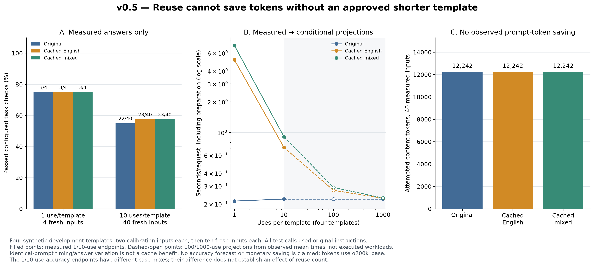
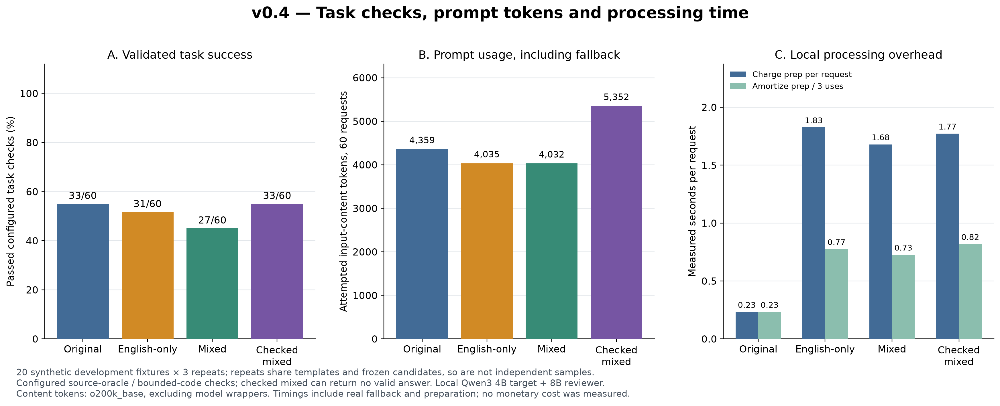

# Multilingual Prompt Optimizer

A local Python research tool that selects shorter prompt representations while
keeping source text and code separate from editable instructions.

It counts every **complete candidate prompt**, rejects candidates that grow or lose
protected numeric/literal strings, and keeps the original as a fallback. It builds
on [PromptMin](https://github.com/DelvyG/promptmin) for automatic English/Spanish rule
rewriting and supports user-supplied multilingual phrase alternatives.

**Status:** working research prototype. The `optimize` command selects supplied/rule
alternatives without inference. The new `auto` command generates translations and
reformulations using a local Ollama model, then runs a separate semantic judging
pass. Neither structural checks nor model judgments prove equivalent meaning,
answer accuracy, or lower total cost.

## v0.5: reusable instruction cache

`TemplateCache` stores calibrated instructions and identity metadata, not source
payloads or answers. It recounts the full prompt for each new input, invalidates on
context/fingerprint changes, and keeps the original if reuse would increase tokens.
Applications must still validate each task answer. The key must include current
model revisions/options and task/protocol/validator identity; the study includes
the target model profile in the protocol fingerprint.



Four longer templates used two calibration inputs each, followed by 40 fresh inputs.
**No shortened template survived preparation**, so all policies used original
instructions and attempted the same 12,242 content tokens. A cache hit avoided
repeating preparation but did not create token savings. The 100/1,000-use points
are projections, not executed workloads; no monetary or meaningful time break-even
was demonstrated. See [the reuse study](docs/template-reuse-study.md).

```bash
python research/evaluate_template_reuse.py --output results/local/template-reuse.json --cache-dir results/local/template-cache --refresh
python research/plot_template_reuse.py --input results/local/template-reuse.json --output-dir results/local/figures
python research/run_cached_template.py --study results/local/template-reuse.json --cache-dir results/local/template-cache --template code
```

## v0.4: validate actual task answers

The new task gate checks configured extraction, filtering, arithmetic and small
Python-function answers. If a compressed answer fails, it tries the original prompt
with a real extra inference call. If both fail, it returns no validated answer.
It requires a configured oracle; it does not certify arbitrary sentences.



In the 20-fixture × 3-repeat development run, original prompts passed 33/60 checks,
mixed prompts 27/60, and checked mixed 33/60. The gate recovered the losses but
used 22.8% more attempted prompt-content tokens than original. It withheld answers
on 27/60 requests. These are small configured-oracle results, not general accuracy.
See [the task-quality study and graphs](docs/task-quality-study.md).

Check an existing answer without model calls:

```bash
mpo validate --case data/task-quality-development.json --id E01 --answer examples/task-answer-valid.json
```

Run a real checked example after the Ollama setup below:

```bash
python research/run_checked_case.py --id F03 --output results/local/checked-demo.json
```

Applications can use `execute_checked(original_prompt, candidate_prompt, execute,
validate)` with an execution callback and an `AnswerCheck` validator. The built-in
`validate_answer(case, response)` uses the supplied task configuration. A passing
reviewer opinion alone is not a passing task check. The existing `auto` command
still performs instruction review; use the checked API for configured answer gating.

## Quick start

Requires Python 3.11 or newer. From the extracted project folder:

```bash
python -m venv .venv
```

Activate the environment:

```powershell
# Windows PowerShell
.venv\Scripts\Activate.ps1
```

```bash
# macOS / Linux
source .venv/bin/activate
```

Install and run:

```bash
python -m pip install -e .
mpo optimize --input examples/summary.json --output results/local/summary.json
mpo optimize --input examples/summary.json --text
```

The first use of a `tiktoken` encoding may download its public vocabulary. Prompt
contents stay local. There are no model weights, API keys, accounts, or inference
service calls involved in these commands.

## What works

- Automatic multilingual candidate generation and semantic judging through local Ollama.
- Automatic rule candidates from the pinned PromptMin 0.3.0 dependency.
- Bounded search over supplied phrase alternatives, including monolingual choices.
- Full-message token counting with `tiktoken`.
- Optional local Hugging Face `tokenizer.json` support for Qwen, Llama, or other families.
- Exact preservation of the separate source payload and output instruction.
- Rejection of candidates that remove instruction-side numeric strings or explicitly
  protected literals, or increase the final token count.
- A Python API, command-line interface, local benchmark runner, and auditable JSON results.

## Input format

```json
{
  "instruction": "Please summarize the update in exactly three bullet points.",
  "payload": "The pilot has 120 users. 96 completed onboarding.",
  "output_instruction": "Respond in English.",
  "protected_literals": [],
  "phrase_options": [
    {"en": "Summarize the update.", "zh": "总结以下更新。"},
    {"en": "Use exactly 3 bullets.", "zh": "恰好3个要点。"}
  ]
}
```

`instruction` is the original request. `payload` holds material that must not be
rewritten, such as source documents, quotations, JSON schemas, or code. The sections
are joined with blank lines; their contents are not normalized.

Each `phrase_options` entry describes equivalent choices for one clause. The tool
evaluates their Cartesian product, recounting the whole prompt each time. Language
labels are descriptive, not verified by a language detector. The default limit is
256 combinations; exceeding it produces an explicit error.

You can also provide complete alternatives:

```json
{
  "instruction": "Please list exactly 3 risks from the supplied text.",
  "payload": "A supplier is late. Testing is incomplete. The budget is nearly exhausted.",
  "candidates": [
    {"label": "concise English", "instruction": "List exactly 3 risks."},
    {"label": "Chinese", "instruction": "列出恰好3项风险。"}
  ]
}
```

Supplying equivalent alternatives is the caller's responsibility. A shorter candidate
that passes structural checks may still change meaning. Review candidates before
using them in consequential tasks.

## Automatic mode for new sentences

Install [Ollama](https://ollama.com/download), start it, then download a local
multilingual generator and reviewer once (approximately 2.5 GB and 5.2 GB):

```bash
ollama pull qwen3:4b
ollama pull qwen3:8b
mpo auto --input examples/automatic.json --model qwen3:4b --verifier-model qwen3:8b --output results/local/auto.json
```

Edit the example's `instruction` and `payload` to try your own text. No prewritten
`phrase_options` are required. Default languages are English, Chinese and Japanese.
The tool generates aligned clauses, searches up to 256 combinations, then asks a
model to judge the shortest structurally acceptable complete instructions. It
selects the first approved candidate, or keeps the original if none is approved.

The example uses Qwen3 4B to generate and Qwen3 8B to review. The 8B reviewer got
20/20 labels right on our small synthetic reviewer development set; 4B got 10/20,
rejecting all valid rewrites. This supports the example configuration on these
cases, not general semantic reliability. If `--verifier-model` is omitted, the same
model generates and judges. Different model names do not establish independent
validation or task accuracy. See [the study](docs/reviewer-study.md).

**Observed limitation:** the reviewer-approved demo reduced 69 to 65 content tokens,
but its target-model summary omitted a required review date. The original response
kept it. This one-run development check is a failure observation, not proof of
causality or a general accuracy rate. Check target-task outputs before relying on
compression; the current prototype does not provide automatic task-quality gating.

Source payloads stay outside the model-generation and judging requests. The
instruction and unchanged output constraint go to the configured loopback Ollama
endpoint. No cloud model names or remote endpoints are accepted. Inference uses
local compute and can cost more time/resources than the input tokens saved.

If generation or judging fails, JSON output retains the original, records the error,
and the CLI exits with code 2. Look at `automation.status`, `judgments`, `model_calls`,
and `generated_phrase_options` for the audit trail. Model approval is recorded as
`judge_approved`; `semantic_equivalence_verified` remains false because it is not a
proof. See [automatic-mode details and limits](docs/automatic-mode.md).

## Python API

```python
from multilingual_prompt_optimizer import Candidate, Request, optimize

result = optimize(
    Request(
        instruction="Please list exactly 3 risks from the text.",
        payload="Supplier delay; incomplete testing; budget overrun.",
        candidates=(Candidate("concise", "List exactly 3 risks from the text."),),
    )
)

print(result.prompt)
print(result.saved_tokens)
print(result.to_dict())
```

Equal-token alternatives keep the original. Results include every candidate, its
count, acceptance decision, rejection reasons, and selection label.

## Other tokenizers

Install the optional dependency and supply a tokenizer file obtained from its
publisher:

```bash
python -m pip install -e ".[hf]"
mpo optimize --input examples/summary.json --tokenizer-json path/to/tokenizer.json
```

This reads the local tokenizer file and records its SHA256 fingerprint. It does not
download model weights. Counts describe the composed user-message content, not a
provider's chat template, hidden system prompts, reasoning tokens, or billable usage.

## Reproduce the local benchmark

```bash
mpo benchmark --input data/development.json --output results/local/development.json
mpo benchmark --input data/spanish-coverage.json --output results/local/spanish.json
```

The runner compares automatic rules, supplied alternatives, and their combined pool,
always retaining the original as fallback. The multilingual options in these corpora
were authored in advance; their generation cost is not measured. The Spanish set is
a separate supported-language diagnostic, not an independent validation set.

See [data provenance](data/README.md), [research findings](docs/research.md),
[benchmark totals](results/README.md), and the checked-in
[example result](examples/summary-result.json). Token reductions are not
measured monetary savings.

## Development

```bash
python -m pip install -e ".[dev,hf]"
ruff check .
python -m unittest discover -s tests -v
python -m build
```

The current local engineering suite has 73 tests. These test implementation behavior,
not a guarantee of model task accuracy. Install `.[plots]` to regenerate the charts.

GitHub Actions runs checks on Windows/Linux and Python 3.11/3.12. Check the
[Actions page](https://github.com/Ksiuhl/multilingual-prompt-optimizer/actions)
for the result of each uploaded revision.

## Research and attribution

This project combines existing ideas and does **not** claim to invent multilingual
compression. PromptMin is an upstream dependency, not code presented as our own work.
See [third-party notices](THIRD_PARTY_NOTICES.md) and [related work](docs/research.md).

The next research step is real-model evaluation and independent semantic checks on
unseen tasks. LLM-to-LLM compression
is planned future work; see the [project brief and architecture](docs/project-brief.md)
and [roadmap](docs/roadmap.md).

## Upload to GitHub

Project repository: [Ksiuhl/multilingual-prompt-optimizer](https://github.com/Ksiuhl/multilingual-prompt-optimizer).
To publish your own copy, follow [the publishing steps](docs/github-upload.md).

## License

Project code and the synthetic datasets are MIT licensed. Dependencies retain their
own licenses. See [LICENSE](LICENSE) and [THIRD_PARTY_NOTICES.md](THIRD_PARTY_NOTICES.md).
