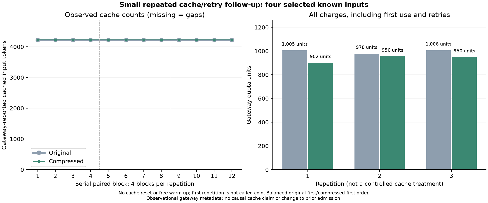

# Small paid cache/retry follow-up

**Result:** all 24 responses were correct. Compressed prompts incurred **6.06%
less gateway quota consumption** in this run. Every response reported 4,224 cached
input tokens, and there were no retries. This is encouraging diagnostic evidence,
not a new holdout benchmark or permission to enable the rejected template.

## Prospectively frozen design

We reused four exact prompt pairs from the earlier extraction study: the prior
exceptional accounting case (`development-108`), a prior timeout case
(`development-109`), a higher-output ordinary case (`holdout-911`), and the
Unicode/numeric-string supplement case (`holdout-supplement-0`). These were
chosen for diagnosis, not as a population sample.

Each pair was repeated three times: four known inputs, 12 paired observations,
24 planned requests. The protocol, selected cases, prompt strings, grader and
runner were hashed before inference. Paired blocks ran serially; six blocks
were original-first and six compressed-first, with order randomized before
execution. Every actual request followed that frozen order.

The same unverified `gpt-6.1-sol` gateway label was used with default sampling
and reasoning, streaming, a 4096-token output limit, a 60-second attempt deadline
and at most two attempts for transient errors. The run needed only 24 attempts.
Serial execution differs from the previous study's concurrency of two; this was
not a controlled comparison of concurrency or endpoint load.

There was **no cache reset, cache busting or free warm-up**. Previous experiments
may already have affected cache state. The first repetition is not called cold,
and reported positive cache counts are observational metadata rather than a
controlled warm-cache treatment. Every first repetition and any retry would
count in the result.

A soft 25,000-quota-unit stop was checked between paired blocks; this was
not a guaranteed spending ceiling. The actual debit stayed below it. No new
candidate generation or translation calls were made.

## Accuracy and matched charges

| Arm | Exact passes | HTTP attempts | Matched charged quota |
|---|---:|---:|---:|
| Original | 12/12 | 12 | 2,989 |
| Compressed | 12/12 | 12 | 2,808 |
| **Total** | **24/24** | **24** | **5,797** |

The reduction is **181 gateway quota units (6.06%)**. All response request IDs
matched consumption records. Their sum exactly matched the key-specific quota
increase, which was unchanged in a later read. The comparison uses gateway quota units, not official-provider prices
or independently audited upstream charges. Only matching study
records, public units and counter deltas are retained publicly.

| Repetition | Original exact passes | Compressed exact passes | Original quota | Compressed quota |
|---|---:|---:|---:|---:|
| 1 | 4/4 | 4/4 | 1,005 | 902 |
| 2 | 4/4 | 4/4 | 978 | 956 |
| 3 | 4/4 | 4/4 | 1,006 | 950 |

All three repetition totals favored compression, but individual pairs did not
always do so: three of 12 paired blocks cost more with compression. Original-first
blocks totaled a -93-unit compressed-minus-original difference; compressed-first
blocks totaled -88. These small descriptive counts do not establish a causal
order effect or statistical population result.

Median client request time was 2.17 seconds for originals and 3.53 seconds for
compressed prompts. These descriptive timings do not establish a causal latency
effect, and lower credit usage did not imply faster responses in this run.

## Cache and output observations

All 24 responses reported **4,224 cached input tokens**: original and compressed
cache counts were equal in every pair. No zero-cache or missing-cache response
was observed. The earlier exceptional pair did not recur as an unreported-cache
case in this small follow-up. That does not establish that it cannot recur or
prove the reason for the earlier anomaly.

Reported input totaled 56,394 tokens for originals and 55,626 for compressed
prompts, a 768-token reduction. Both arms reported 50,688 cached tokens. Outputs
rose from 346 to 377 tokens, partially offsetting the input saving. No source,
instruction or answer-format repair was applied after responses were seen.



## Interpretation

This shows that the same compressed instruction can retain accuracy and reduce
measured charges in a small run where reported cache counts match and retries
are absent. It does **not** demonstrate general net savings, authenticated cache
state, model identity, or reliability on new tasks. Four selected known inputs
are not twelve independent questions.

The earlier 64-response experiment remains cost-rejected and unchanged. We do
not replace it with this favorable subset or append these observations as fresh
holdout admission evidence. The original-only default remains unchanged; no
template is automatically admitted.

Before admission, a separate prospective study should use distinct development
and unseen inputs, repeated balanced ordering, observed cache strata, and full
warm-up/retry costs. For this simple JSON projection, deterministic extraction
still avoids model inference entirely.

## Reproduce offline

```bash
pip install -e ".[plots]"
python research/analyze_cache_followup.py results/cache-followup-v060 --out results/local/cache-followup-v060
```

The script verifies frozen hashes, exact identity with prior prompt strings,
serial order, every attempt, the unchanged grader, matching charges and counter
reconciliation. It regenerates summary/trial/attempt data and PNG/SVG/PDF graphs
without model or billing calls. Keep the original extraction bundle available
for prompt-identity checks.
