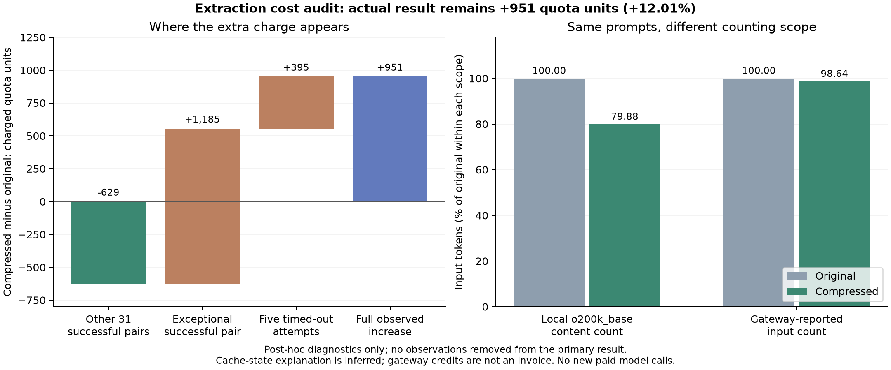

# Why the shorter extraction prompt cost more

This offline audit uses the saved a4 experiment only. **No new model or billing
calls were made.** All 64 completed answers remain correct, and admission remains
rejected by cost. No observations or charges were removed from the primary result.

## Exact decomposition of the observed increase

| Compressed minus original | Charged quota difference |
|---|---:|
| Other 31 successful pairs | -629 |
| One exceptional successful pair | +1,185 |
| Five timed-out attempts | +395 |
| **Full experiment** | **+951** |

Original charges were 7,918 units; compressed charges were 8,869, **12.01% higher**. The components sum exactly to the increase and
reconcile to the saved gateway quota counter. These are gateway measurements,
not official-provider prices.

The 31-pair subset is a post-hoc diagnostic, **not a replacement savings result**
or a new admission sample. The real gate still includes the exception and all
charged retries.

## The exceptional response and cache accounting

The exceptional pair is `development-108`. Both answers were correct and both
reported 24 output tokens:

| Measurement | Original | Compressed |
|---|---:|---:|
| Local full-prompt tokens, o200k_base | 320 | 256 |
| Gateway-reported input tokens | 4,706 | 4,642 |
| Reported cached input tokens | 4,224 | **Breakdown absent** |
| Charged quota | 244 | **1,429** |

The larger fee therefore is not explained by a longer client prompt or reported
output in this pair. This was the only successful response without a cache
breakdown. **Missing metadata does not prove a cache miss.** It could reflect
cache state, routing, or gateway accounting.

Using the [previously saved gateway pricing expression](../results/heldout-v060/pricing.json)
and an inferred effective multiplier of 0.3, all **69 attempt charges** match
nearest-integer quota rounding:

```text
modeled quota = round(0.3 × (input - 0.95 × cached + 5 × output))
```

For this diagnostic, absent cache counts and unreported cache writes are assumed
zero, and the saved short-context price coefficients are used. The multiplier
was fitted from 63 successful responses with cache counts; its median estimate
was approximately 0.30005. It is not authenticated account-group metadata.
This numerical fit supports a cache-discount billing explanation, without
observing the actual upstream cache or proving why it changed.

For illustration, assigning the original's 4,224 cached tokens to the exceptional
compressed response gives about 225 units under this formula instead of 1,429.
That is **hypothetical**, not a measured charge or a revised result.

## Retries, outputs, and counting scope

Five first attempts timed out, all in the compressed arm. Their charges were
80, 79, 79, 80 and 77 quota units: **395 total**. Retried requests completed
correctly. Those failed attempts lacked client usage objects, but matched
billing logs supplied input counts and zero reported output counts. Ignoring
them would understate the debit. This does not show that compression causes
timeouts; network, endpoint load and sampling were not isolated.

Across the 32 paired fixtures, compression removed 64 tokens per request in
both the local count and the reported input-count difference:

| Scope | Original | Compressed | Reduction |
|---|---:|---:|---:|
| Local complete content, o200k_base | 10,180 | 8,132 | **20.12%** |
| Gateway-reported successful input | 150,532 | 148,484 | **1.36%** |

Every successful call reported exactly **4,386 more input tokens** than its local
content count. That constant difference suggests additional context or an
accounting component. The target tokenizer and hidden context are unverified;
it does not reveal a particular hidden system prompt.

Successful outputs increased from 975 to 1,003 reported tokens: **28 extra**.
That adds only 42 modeled quota units under the fitted formula, much smaller
than the exceptional cache-accounting difference and timeout fees. Cache counts
also varied between ordinary pairs; they matched in 24 of 32 pairs.



## Next experiment

For simple projection, use the existing deterministic `template.expected` path
and avoid model inference.

For compression research, freeze a repeated protocol on a task that needs an
LLM. Pair requests on the same inputs, randomize order across repetitions, retain
warm-up costs and every failed attempt, and record cache metadata and charges.
If cache state cannot be controlled, stratify observed cache categories and
label missing metadata as unknown. Do not claim controlled warm/cold state from
inference alone. Keep the current original-only default and cost rejection.

## Reproduce without paid calls

```bash
pip install -e ".[plots]"
python research/audit_extraction_costs.py results/validated-extraction-v060 --out results/local/extraction-cost-audit
```

The audit verifies frozen hashes, every attempt/request ID, ledger totals, the
stable counter and the exact decomposition. It regenerates summaries, attempt
traces, the billing-fit diagnostic and PNG/SVG/PDF graphs from saved records.
Tiktoken's encoding asset must already be cached for a completely offline run.
The script does not contact inference or billing endpoints.
