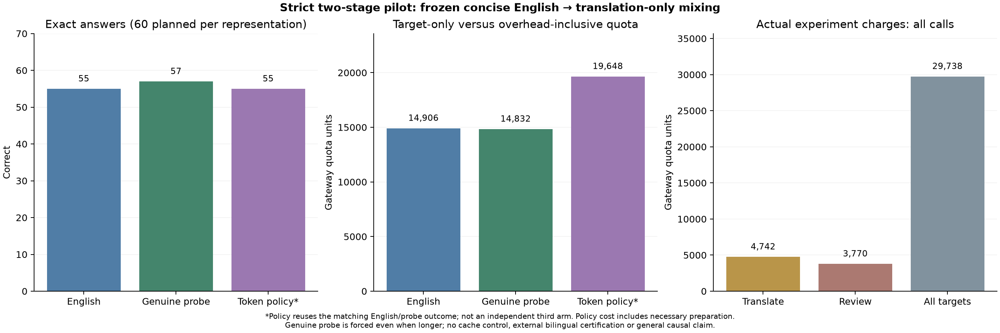
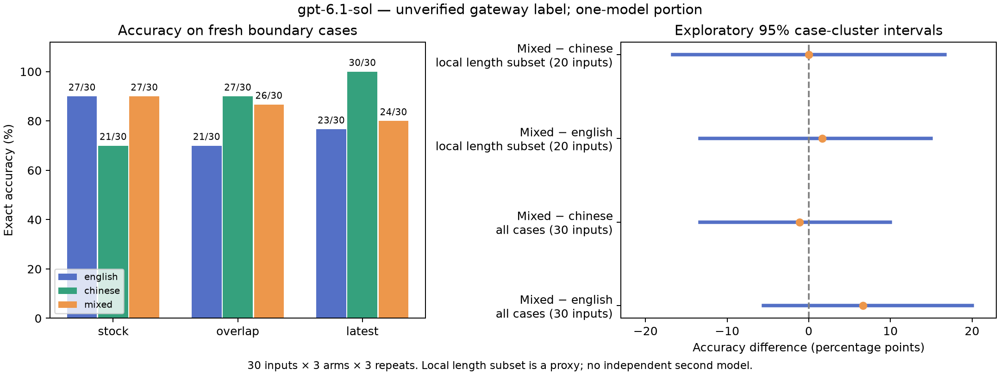

# Research conclusion and closeout

Closed on 4 November 2026 (Hong Kong). This report closes the current investigation using the recorded evidence; no additional model calls were made for the closeout.

## Conclusion

**The experiments did not establish that mixing languages after concise-English compression reliably reduces total cost or improves accuracy beyond a single-language alternative.** The evidence does not justify promoting general multilingual compression as a proven optimization or continuing open-ended paid exploration of the same premise.

These are negative cost findings and inconclusive accuracy findings within the tested scope, not proof that every possible multilingual prompt is ineffective. The project delivered a working, auditable research prototype, rather than a demonstrated breakthrough or a generally validated cost-saving product.

## Evidence behind the decision

These studies have different inputs and, in places, different transport wrappers. Their answer counts must not be pooled or interpreted as before/after progress on one benchmark.

| Study | Observed result | Supported interpretation |
|---|---|---|
| Strict English-first two-stage pilot: 20 inputs, three target repeats | English 55/60; forced genuine mix 57/60. No mixed candidate was shorter on any of the 20 inputs. The actual token policy retained English throughout. | A small diagnostic accuracy lead did not establish a general advantage. The proposed second stage supplied no incremental input-token saving in this pool. |
| Same pilot, preparation-inclusive policy accounting | 19,648 quota units versus 14,906 for the frozen-English baseline: **31.81% more** at the tested reuse level. | Translation overhead outweighed the observed benefit. Policy observations reuse the selected arm; this is an accounting scenario, not an independent production execution. |
| Three-language controls: 30 fresh inputs, three arms, three repeats | English **71/90**, Chinese-only **78/90**, mixed **77/90**. Mixed minus English: +6.67 percentage points, exploratory 95% case-cluster interval **[-5.56, 20.00]**. Mixed minus Chinese: -1.11 points, **[-13.33, 10.00]**. | Mixed scored higher than English, but not higher than Chinese-only. Both intervals include zero; a mixing-specific accuracy benefit remains unestablished. |
| Same language-control run, target usage | Mixed used **510 more reported input tokens** and **5.25% more target-only quota** than English. | This run showed no input saving or lower target charge from mixing. Output usage and cache behavior prevent treating the quota difference as a pure causal language effect. |

The three-language follow-up used **68,162 gateway quota units** across all 275 model-endpoint attempts, including setup failures and successful reviews. Its 270 target requests completed without transport retries or answer repairs. All completed-run request charges matched consumption records, and the full follow-up reconciled to interval counters. These are gateway units, not official-provider prices or currency estimates.

Language-dependent wording remains an observational lead, not a confirmed mechanism. Chinese-only scored 30/30 on latest-state selection versus 23/30 English and 24/30 mixed, but 21/30 on stock filtering versus 27/30 for each other arm. Selected inputs had repeatable failures; others varied across repeated identical prompts. This does not prove that differences are entirely random, nor that a particular language causes an advantage.

An earlier narrow English-extraction follow-up also matters: both arms passed 60/60, with 5.90% lower compressed quota under that run's conditions. However, the original template admission experiment failed its development cost gate, and the later observation did not reverse that rejection. The projection is computable without an LLM. This is evidence for careful, scoped measurement, not general profitable English compression.

## What was completed

The repository provides full-prompt tokenizer counting; bounded candidate and phrase search; immutable source payloads; numeric/literal guards; explicit opt-in compression; original fallback; a byte-checked English freeze and translation-only second-stage API; task-output validation; and benchmark/audit tools with raw synthetic fixtures, outputs, charge evidence and graphs. It credits the existing PromptMin baseline rather than claiming ordinary English rewriting as a new invention.

The [strict-stage report](strict-two-stage-pilot.md) and [language-control report](language-control-followup.md) retain the detailed methods, failures, denominators and reproducible offline audits. The [extraction report](validated-extraction.md) retains the cost-gate rejection. Code checks and model-answer correctness are separate measurements; passing unit tests does not make every model answer correct.

## Limits that remain unresolved

- The latest controlled study completed only one **unverified third-party gateway label**. Grok routes were paused and Gemini variants failed upstream; they produced no scored benchmark answers. A verified second-model replication was not completed.
- The cases are synthetic and cover familiar, selected task families. Repeated answers share input and template structure; the intervals are conditional, exploratory estimates, not broad population guarantees.
- Chinese translations were author-written and reviewed by the same available gateway label that answered. Independent bilingual review and a fresh clearer-English control were not completed. Translation wording and clarity remain possible explanations.
- The local token-length subset is a proxy, not model-native length matching. Cache state, gateway wrappers, provider-default sampling/reasoning and a recorded metadata cooldown were uncontrolled.
- Human authoring and engineering costs were unmeasured. The structured tasks have deterministic implementations, so this is a prompt-following stress test rather than evidence that these workloads need an LLM.

These limitations narrow the conclusion. They are recorded as deferred work, not silently treated as completed tests.

## Final recommendation and project status

**Close the current multilingual cost-saving investigation and preserve the repository as an experimental benchmark and portfolio project.** Do not claim a universal compressor, a unique accuracy advantage from mixing, a profitable admitted template, or a demonstrated research breakthrough. Existing original-only defaults remain appropriate; no new template is admitted by this report.

If the code is reused, compare any concise rewrite against the original on the actual task, include generation/verification/output/retry costs, and validate outputs. Use deterministic code directly for these structured tasks when suitable. English rewriting and validation remain possible engineering directions, not newly proven production savings.

No further paid experiment is scheduled. The clearer-English control and second-model comparison are deferred and are not required to close this report. Reopening should be a separately scoped investigation with a strong English baseline, fresh independent inputs, authenticated model identity and a predeclared decision rule. Phase 2 on agent communication or learned protocols remains unimplemented and should be justified independently; Phase 1 did not validate its assumed savings.

## Recorded graphs

The plots describe separate studies and should not be read as one pooled experiment.

**Strict two-stage pilot:** policy overhead and forced-diagnostic observations.

**Three-language controls:** observed task scores and exploratory paired intervals on the new inputs.

