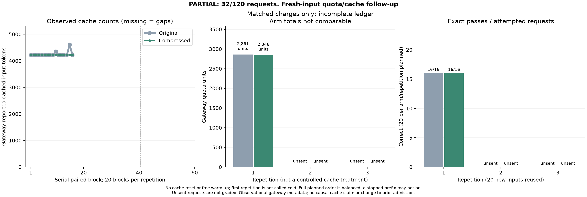

# Fresh-input paid quota/cache study

**Partial result:** 32 of 120 planned requests were sent, covering 16 new inputs
once in each arm. Both arms passed **16/16 exact checks**, with 32 HTTP attempts
and no retries. The quota-metadata endpoint persistently returned HTTP 429, so
inference stopped. The remaining 88 requests were **not sent or graded**.

This is not a completed three-repetition study. The observed prefix contains
seven original-first and nine compressed-first pairs; only the full planned
sequence has balanced order.

| Observed arm | Exact passes / attempted | Reported input tokens | Reported output tokens |
|---|---:|---:|---:|
| Original | 16/16 | 75,614 | 540 |
| Compressed | 16/16 | 74,590 | 501 |

Reported input usage decreased by **1,024 tokens (1.35%)** on the completed
pairs. This is a token observation, not a verified reduction in total charged
quota. All 32 responses reported positive cache counts; 14 of 16 pairs had equal
counts. Reported cached-token values were 4,224, 4,352 and 4,608.

Only **23/32** request IDs currently have saved consumption records (11 originals,
12 compressed). Their matched charges total 5,707 quota units, but missing
records are **unknown, not free**. The final key-counter read was rate-limited;
the last verified counter increase was 7,430 units after 30 responses, before
the final pair. Consequently, the full charge total and net saving remain
unresolved. Comparing the unequal-coverage arm subtotals would be invalid.

Median client request time was 4.82 seconds for originals and 3.77 seconds for
compressed prompts. This excludes pauses between pairs and is descriptive only.
There were no observed answer errors or model-request failures; gateway metadata
availability prevented completion.



This study compares the existing original and compressed extraction instructions
on 20 new JSON payloads, with three repetitions planned for each arm: 120
requests in 60 serial paired blocks. The fixed task copies `customer.name`,
`order.id` and `payment.amount` into an exact JSON answer. It is one projection
schema, not 60 independent tasks or a general multilingual benchmark.

## Frozen design

Before inference, `protocol.json` froze the dataset, all full prompt strings,
expected answers, grader, template and runner by SHA-256. Payloads and expected
answers are individually distinct. Canonical payloads are disjoint from the
earlier extraction study, its uniqueness supplement and the four-input cache
follow-up. The instructions and immutable output contract were reused exactly;
there was no new candidate-generation, translation or judging call.

Inputs cover multilingual names, significant whitespace and escapes, missing
paths, nulls, empty strings, booleans, numeric strings and ordinary numbers.
Archived values and instruction-like notes are distractors in source data.
Expected answers were assembled independently and cross-checked against the
deterministic projection before any inference.

Each repetition randomizes the 20 cases and balances ten original-first and ten
compressed-first pairs. Repetition two reverses each case's first arm from
repetition one. The full same prompt strings are reused across repetitions.

The unverified `gpt-6.1-sol` gateway label is called serially with provider-default
sampling/reasoning, streaming, a 4096-token output cap, a 60-second deadline and
at most two attempts for transient failures. No keys are published. There is no
cache reset, cache busting or free warm-up: first repetitions and every retry
count. Prior traffic may affect every repetition, including the first.

A 75,000-quota-unit soft stop is checked between paired blocks. This is not a
guaranteed ceiling. Inference pauses when quota metadata cannot be read, and
authentication or quota failures stop the route. No alternate key is used to
work around limits. Metadata interruptions and elapsed gaps are retained.

## Analysis and interpretation

The offline analyzer verifies all frozen hashes, full composed prompts, unique
case/arm/repetition identities, serial request order, exact answers and complete
attempt accounting. It matches request IDs to consumption records, retains only
study-matching billing fields, and compares their sum with a key-counter delta.
Unknown cache counts and charges remain unknown. Missing answers fail; completed
quality failures and incomplete requests are reported separately.

The descriptive analysis plan was written after inference began, before answer
grading. There is no significance test or confidence interval. Per-repetition
charges, cache counts, first-arm groupings and repeat instability describe this
run; they do not identify a causal cache, order or latency effect. Client request
times include retry waits and exclude study pauses between paired blocks.

This is controlled compression/accounting research. The projection itself is
deterministic without an LLM. Model identity and gateway accounting are not
independently authenticated. Results do not establish a multilingual advantage,
replace earlier negative studies, admit the previously rejected template, or
change the original-only application default.

## Reproduce offline

```bash
python -m pip install -e ".[dev,plots]"
python research/analyze_fresh_cache.py results/fresh-cache-v060 --out results/local/fresh-cache-v060
```

This command makes no inference or billing calls. It requires the earlier frozen
extraction and cache-follow-up bundles for identity and disjointness checks.
