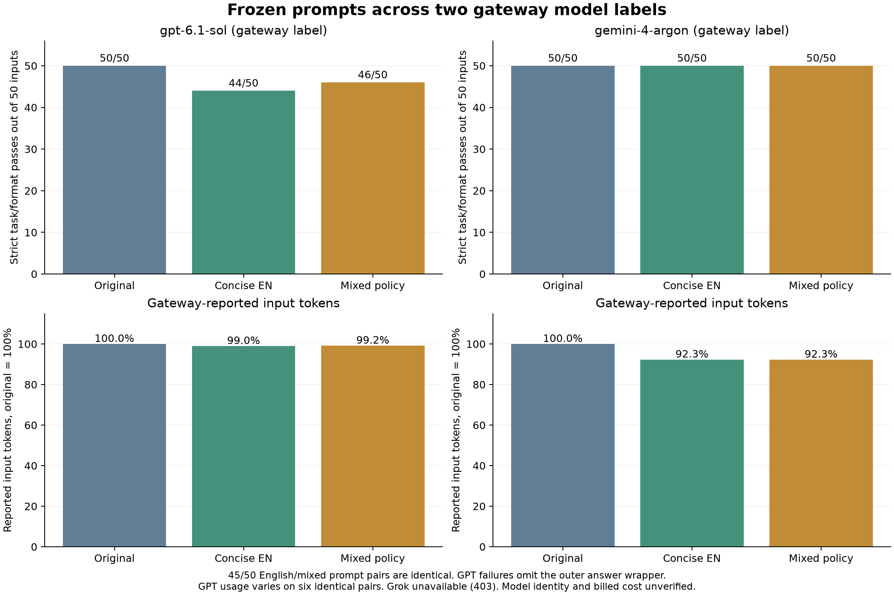

# v0.6 recorded gateway transfer study

This development study tests whether previously prepared prompts transfer to two
gateway-supplied model labels. It is not independent verification of those model
identities and is not per-target tokenizer optimization.

## Frozen protocol

Fifty assistant-authored synthetic inputs cover extraction, filtering, decimal
arithmetic, constrained factual summaries and bounded Python repair. There are
ten reusable instruction templates and five inputs per template. These are new
development inputs, not an externally curated held-out benchmark. Code inputs
share two target behaviors. Summary checking is a fact/format rubric rather than
a general semantic quality measure.

Each input has original-English, concise-English and mixed-policy versions. The
English baseline was strengthened with manually concise aligned clauses before
all target evaluation. Gemini 3.5 Flash-Lite generated alternatives for eight
templates; two code templates used explicitly recorded assistant-authored
translations after preparation inference failed. Whole-instruction model reviews
are fallible and did not filter or hide task results. Failed and discarded
preparation is retained in the preparation archive.

One greedy coordinate pass used Gemini 3.6 `countTokens` on the complete wrapped
calibration prompt, excluding evaluation answers. Its selected strings were
frozen and transferred unchanged to the gateway. Only one of ten mixed-policy
templates selected a Chinese clause. Nine remained identical to concise English.
No Japanese alternative reduced the selected prompt in this pool. This is a
bounded search result, not proof that better multilingual alternatives cannot exist.

The gateway exposed `gpt-6.1-sol`, `gemini-4-argon`, and `grok-4.7`. The first two
completed 150 requests each: one per input/arm, without answer-based reselection
or fallback. Arms were shuffled within each input with seed 20261103. The first
four requests/model used concurrency one, then concurrency two. Per-request
timing is observed client latency under that schedule, not intrinsic model speed.
Requests used a 4,096-output-token limit, provider-default reasoning/sampling and
streamed chat completions. Transport schema guidance was conveyed in the same
user-message format for all arms; native output schemas did not enforce answers.
Transient transport/server errors had at most two attempts. Grok stopped after a
403 `routes_paused` response and has no task-accuracy measurement.

## Results

| Gateway label | Original strict checks | Concise English | Mixed policy |
| --- | ---: | ---: | ---: |
| `gpt-6.1-sol` | 50/50 | 44/50 | 46/50 |
| `gemini-4-argon` | 50/50 | 50/50 | 50/50 |

All ten failed GPT-labelled responses were summaries missing the required outer
`answer` wrapper: six concise-English and four mixed-policy responses. Their
facts pass the frozen rubric after a separately labelled diagnostic adds that
wrapper. The primary strict scores above are not corrected or replaced. This
distinguishes a formatting failure from lost required facts; it does not certify
all aspects of summary meaning or writing quality.

Forty-five of fifty English/mixed prompt pairs are byte-identical. Two GPT-labelled
pass/fail changes occurred on those identical prompts, so the 44-versus-46 score
difference is not evidence that mixing improved accuracy.

| Reported input tokens | Original | Concise English | Mixed policy |
| --- | ---: | ---: | ---: |
| `gpt-6.1-sol` | 228,710 | 226,349 | 226,841 |
| `gemini-4-argon` | 33,173 | 30,618 | 30,613 |

The Gemini-labelled endpoint reduced inputs by 7.7% with concise English. Mixing
saved five further input tokens, approximately 0.02% relative to concise English.
The GPT-labelled endpoint reported input differences of plus/minus 164 tokens
on six byte-identical English/mixed pairs. Hidden gateway context, routing and
usage accounting are not observed, so its raw token totals cannot isolate prompt
content savings. Cached-input counts and raw usage are retained; token amounts
across the two labels are not comparable measures of tokenizer efficiency.



## Overhead, costs and uncertainty

The retained preparation records contain 37 known model attempts, with 11,401
reported input tokens and 8,713 output tokens across attempts with usage data.
Three retained attempts have no usage. Recorded template preparation time totals
about 96 seconds; 464 token-counting requests have about 77 seconds of summed
request latency, partly concurrent and overlapping template timing. These are not
additive wall times. A kernel-reset interrupted another preparation request whose
completion/usage is unknown, so overhead is a recorded lower bound. The discarded
English-copy draft and malformed-JSON preparation are included.

Actual gateway prices and invoices were unavailable. Unknown usage on failed
requests remains unknown. No dollar savings or amortization break-even is claimed.
The earlier direct Gemini study stopped at 14 successful extraction answers due
to a per-project/model free-tier daily quota; those answers are not merged here.

The findings support testing concise English first on these templates. They do
not establish general correctness, a multilingual advantage, a global token
minimum, net optimizer savings or a superior model family. Future work should use
independent inputs, target-specific token selection, repeated trials and measured
provider billing, while retaining a strong concise-English control.

## Artifacts and offline verification

- `data/gateway-v060.json`: frozen inputs and oracles.
- `data/gateway-v060-rubric.txt`: exact pre-evaluation Python rubric, retained byte-for-byte.
- `results/gateway-v060-raw.json.gz`: complete gateway response/attempt records.
- `results/gateway-v060-preparation.json.gz`: direct-provider preparation and interruption records.
- `results/gateway-v060-requests.json`: exact wrapped prompt strings and hashes.
- `results/gateway-v060-summary.json`: strict scores, diagnostics, usage, latency and overhead.
- `results/figures/v060-gateway-comparison.*`: PNG, SVG and PDF exports.

Install the package with plot dependencies, then run:

```bash
python research/analyze_gateway_study.py
```

This makes no model/API requests. It checks the original rubric and prompt hashes,
recomputes scores and diagnostic counts, and writes analysis/graphs under
`results/local/gateway-v060/`. The recorded model identities remain unverified.
