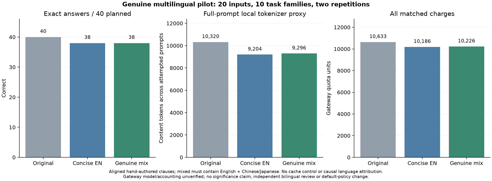

# Genuine English/Chinese mixing pilot

**No mixed-language accuracy advantage was observed in this pilot.**

The pilot planned 120 requests: 20 new source payloads across ten existing task
families, three prompt versions, and two repetitions. Execution complete:
**True**. Unsent requests: **0**.

| Arm | Exact passes / 40 planned | Completed | HTTP attempts | Known matched quota | Reported input tokens | Local content tokens |
|---|---:|---:|---:|---:|---:|---:|
| Original | 40/40 | 40 | 40 | 10,633 | 185,760 | 10,320 |
| Concise English | 38/40 | 40 | 40 | 10,186 | 184,644 | 9,204 |
| Genuine mix | 38/40 | 40 | 40 | 10,226 | 184,736 | 9,296 |

All charges reconcile to **31,045 gateway quota units**. Mixed charges were **0.39% higher** than concise English. These are gateway quota observations, not official-provider prices.

Median client request time (including retry waits) was
4.01 seconds original,
4.08 seconds concise English and
2.63 seconds mixed. These are observational timings,
not an isolated language or model-speed effect.

| Arm | Positive reported cache | Reported zero cache | Unknown cache |
|---|---:|---:|---:|
| Original | 40 | 0 | 0 |
| English | 40 | 0 | 0 |
| Mixed | 40 | 0 | 0 |

Reported usage coverage (attempts with input/output counts) is
40/40 and
40/40 for English, and
40/40 and
40/40 for mixed. Token sums
contain known usage only; missing usage is not evidence of free processing.

There were **2 mixed-only passes** and
**2 English-only passes** in matched case/repetition
comparisons. There were 4 case/arm
groups with different correctness across their two identical-prompt repetitions.
These descriptive observations share cases and task families; they are not
independent trials for a pooled significance test. All 0
incomplete HTTP attempts and any retry charges are retained; there is no answer
repair or original-prompt fallback in this experiment.

Post-grading inspection confirmed four task-rule errors, not JSON-wrapper errors:
English included an endpoint-touching interval and misordered a penalty tie;
mixed omitted qualifying stock records and included a device whose later tied
record was offline. **Every failing case/arm passed its other identical-prompt
repetition.** Both mixed-only wins were balanced by English-only wins; there was
no English-versus-mixed discordance that recurred in both repetitions of the
same case. The original arm passed every case in both repetitions.
`error-audit.json` preserves expected/actual values and the rule checks. No
responses, expected answers or graders were repaired, and no extra calls were made.
This repeat variation does not prove the cause of earlier study differences.

| Task family | Original exact passes | English exact passes | Mixed exact passes |
|---|---:|---:|---:|
| dependencies | 4/4 | 4/4 | 4/4 |
| latest | 4/4 | 4/4 | 3/4 |
| literal | 4/4 | 4/4 | 4/4 |
| overlap | 4/4 | 3/4 | 4/4 |
| phone | 4/4 | 4/4 | 4/4 |
| ranking | 4/4 | 3/4 | 4/4 |
| refund | 4/4 | 4/4 | 4/4 |
| stock | 4/4 | 4/4 | 3/4 |
| unique | 4/4 | 4/4 | 4/4 |
| utc | 4/4 | 4/4 | 4/4 |

| Repetition | Original exact passes | English exact passes | Mixed exact passes |
|---|---:|---:|---:|
| 1 | 20/20 | 19/20 | 20/20 |
| 2 | 20/20 | 19/20 | 18/20 |

## What changed from the earlier mixing studies

Every one of the **20 mixed prompt pairs is genuinely different from English**.
Each candidate contains a full natural-language English clause and a Chinese
clause covering a different task requirement. Field names alone do not qualify
as an English segment. The four candidates per task combine English with Chinese
or Japanese clauses; complete composed prompts determine the minimum under the
genuine-mixing constraint. All selected candidates were English/Chinese: six
Chinese/English clause orders and fourteen English/Chinese orders. Japanese was
considered but never selected; this run provides no Japanese performance result.

The original and concise-English arms share exactly the same immutable source
and field-specific JSON output contract as the mixed arm. Aligned clause slots
cover the same authored rules. Translation equivalence was checked by the
assistant author, without an independent bilingual reviewer; structural and
oracle checks do not prove semantic equivalence.

The English baseline uses concise hand-authored clauses and a conservative
[PromptMin](https://github.com/DelvyG/promptmin) lite pass. Only punctuation and
whitespace changes with the same normalized wording were accepted. PromptMin
left every selected English instruction unchanged. This is **not** an evaluation
of state-of-the-art English compression or a claim that this is optimal English.
The baseline and all rejected candidate strings are retained in preparation data.

Before any target calls, all prompts, expected answers, source data, translations,
candidate choices, grader and runner were frozen by SHA-256. The 20 payloads
are canonically distinct and disjoint from earlier extraction, heldout and cache
studies. New values and boundary combinations reuse ten known task families;
they are not unseen task types. The two UTC and dependency fixtures reuse the
same calculation/dependency structure and differ only in identifiers; twenty
distinct payloads are not twenty independent reasoning problems. Separately written arithmetic/rule derivations
matched all 20 hand-authored expected answers before inference. Both checks
share the same assistant author, not independent external curation.

Full local mixed prompts were 0–5 tokens larger than their English counterparts;
none was locally smaller. Forcing real mixing is an experimental intervention,
not a deployment-policy recommendation. Local `o200k_base` counts include the
whole composed prompt but exclude hidden provider wrappers; this tokenizer is
not authenticated for the gateway model. Local and reported counts remain
separate, and quota differences cannot be attributed to token length alone.

## Execution and limits

The unverified `gpt-6.1-sol` label at the third-party gateway used serial
concurrency, default sampling/reasoning, streaming, a 4096-token output cap,
a 60-second deadline and at most two attempts for transient failures. All three
arms are interleaved within preordered blocks; each case's arm order is reversed
in repetition two. The exact schedule is in the frozen protocol. The gateway
model identity, cache metadata and accounting are not independently authenticated.

A whole-pilot 50,000-unit soft quota stop was checked before inference and after
each 30-request batch. This is not a guaranteed ceiling. Metadata failure pauses
new inference while bounded meter retries wait; no alternate key bypasses a
limit. There is no cache reset, cache busting, free warm-up, response selection
or candidate adaptation. Every first repetition and retry counts. Client latency
includes retry waits but excludes pauses between trials/batches.

New candidate-generation and translation API calls: **0**. These aligned clauses
were authored/reused manually; labor and deployment overhead are unmeasured.
This does not establish the total economics of an automatic translator.

There is no monolingual Chinese control, so any accuracy difference cannot
separate translation wording, language choice and code switching. With two
inputs per family and two repetitions, this is a small synthetic pilot. A ceiling
result cannot prove equivalence, and a difference cannot establish a general
multilingual advantage. Original-only defaults and earlier admission/negative
results remain unchanged.



## Reproduce offline

```bash
python -m pip install -e ".[dev,plots]"
python research/analyze_genuine_mix.py results/genuine-mix-v060 --out results/local/genuine-mix-v060
```

The analyzer makes no inference or billing calls. Earlier frozen bundles are
required for canonical disjointness checks; a cached `o200k_base` encoding is
needed for fully offline token recounting. Dataset, preparation, oracle-check
source, exact responses, all attempts, matching charges and meter deltas are
included. No credentials, balances, lifetime counters or unrelated logs are saved
publicly.
