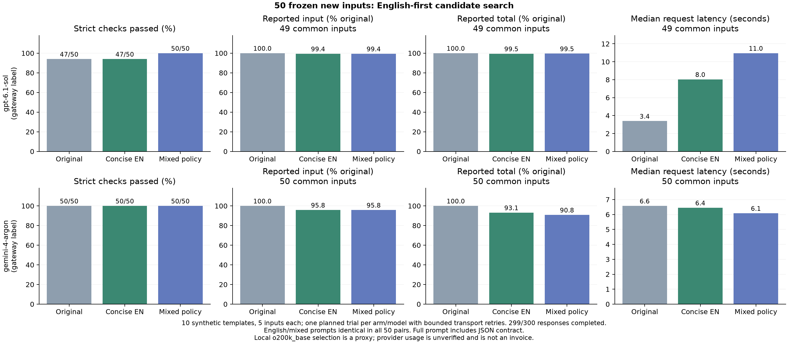

# Frozen new-input check for the v0.6 preview

We authored 50 new inputs across ten new structured-task templates, froze the prompts, candidate pool and exact JSON grader before target requests, and ran original, concise-English and mixed-policy prompts on the same two third-party gateway labels. This is an assistant-authored synthetic check, with five related inputs per template; it is not an external benchmark or independent human evaluation. The earlier 300-response study and 72-response regression remain unchanged.

## Protocol

- Freeze timestamp: `2026-11-03T15:36:17.358290+00:00`; tested optimizer source: `8a2d7f1fed6f2db94fc150376cb07f1d80af7841`.
- New task types: inventory replenishment, half-open interval overlap, latest device status, net settled payments, stable label deduplication, task dependencies, nullable nested extraction, exact Unicode copying, UTC conversion, and multi-key ranking.
- Three arms, 50 inputs each, one target response per input/arm/model. Same candidate prompts transferred to both gateway labels.
- EN/ZH/JA clause alternatives were hand-authored before target calls. Full-prompt exhaustive phrase search and PromptMin lite used local `o200k_base`, a proxy rather than either authenticated target tokenizer.
- The field-specific JSON contract is identical in all arms for each case, included in the full prompt, and left unchanged during selection. No native schema enforcement, response repair, or answer-based candidate revision.
- Exact grading checks nested keys and values, list order, nulls, and Unicode/whitespace inside strings. JSON numeric representations compare numerically; booleans are distinct. Duplicate keys, Markdown, extra keys and wrong types fail.
- All 50 English/mixed-policy prompt pairs are identical. This checks a policy that permits mixing, not a forced code-switching treatment. Any paired answer differences cannot be attributed to different languages.
- Two concurrent requests per route; at most two attempts for transient transport/server errors, with a 60-second per-attempt limit. An execution-cell deadline interrupted the second attempt of one initial GPT-labelled request. Both attempts remain in the raw data; that request was not resent. Recovery details and runner hash are in `execution.json`. Authentication/quota errors would stop a route.

## Accuracy and transport

Strict passes are shown against all 50 planned inputs. Incomplete requests are listed separately and do not count as wrong completed answers. The completed-answer denominator is also reported.

| Gateway label | Arm | Strict passes / planned | Completed responses | Passes / completed | Transport failures |
|---|---|---:|---:|---:|---:|
| gpt-6.1-sol | original | 47/50 | 49 | 47/49 | 1 |
| gpt-6.1-sol | concise_english | 47/50 | 50 | 47/50 | 0 |
| gpt-6.1-sol | mixed | 50/50 | 50 | 50/50 | 0 |
| gemini-4-argon | original | 50/50 | 50 | 50/50 | 0 |
| gemini-4-argon | concise_english | 50/50 | 50 | 50/50 | 0 |
| gemini-4-argon | mixed | 50/50 | 50 | 50/50 | 0 |

## Full-prompt tokens and latency

Local content counts, including source data and the JSON contract: **13,578 original; 12,183 concise English; 12,183 mixed policy** across 50 inputs per arm. Concise English saves **10.27%** on this local tokenizer. Mixed policy adds **zero** further savings. Provider wrappers are excluded from local counts.

The table below uses only inputs with completed responses and usage on all three arms of a model, so missing responses cannot distort token comparisons. These are reported token reductions, not billed-dollar reductions. Negative reductions mean an increase.

| Gateway label | Common inputs | Arm | Reported input reduction | Reported total-token reduction | Median request seconds |
|---|---:|---|---:|---:|---:|
| gpt-6.1-sol | 49 | original | 0.00% | 0.00% | 3.38 |
| gpt-6.1-sol | 49 | concise_english | 0.60% | 0.54% | 8.04 |
| gpt-6.1-sol | 49 | mixed | 0.60% | 0.47% | 10.96 |
| gemini-4-argon | 50 | original | 0.00% | 0.00% | 6.58 |
| gemini-4-argon | 50 | concise_english | 4.22% | 6.87% | 6.45 |
| gemini-4-argon | 50 | mixed | 4.22% | 9.19% | 6.08 |

Request latency spans the first attempt start through the successful attempt end, including retries and retry backoff. It excludes time waiting for a worker, manual candidate authoring, and local search. This is client wall time under concurrent gateway load, not intrinsic model latency. Raw successful-attempt durations and all failed attempts are retained.

Candidate generation made **zero API calls** and used **zero translation API tokens** because the alternatives were manually authored. Human labor cost is unknown. Local search time is recorded in the summary. No claim about the overhead of an automatic translation model follows from this study.

| Gateway label | Request attempts | Attempts without usage | Observed attempt input tokens | Observed attempt output tokens |
|---|---:|---:|---:|---:|
| gpt-6.1-sol | 156 | 7 | 691157 | 7176 |
| gemini-4-argon | 150 | 0 | 96498 | 22505 |

Actual API cost is **unknown**: the active key group, negotiated discounts, balance delta and invoice are unavailable. Failed/interrupted attempts without usage may have incurred charges. Reported usage and gateway model labels are unverified. Cost reductions cannot be inferred directly from input-token counts; outputs, reasoning, caching, rates and retries can change the total.

## Public-price scenario, not actual charges

During execution we retrieved the gateway's public `/api/pricing` response and saved its exact bytes and hash. Its expressions use base prices of $2 per million uncached input tokens, $0.10 per million cached read tokens, and $10 per million output tokens for these short-context text requests. [Upstream New API documents the expression units and cache exclusions](https://github.com/QuantumNous/new-api/blob/main/pkg/billingexpr/expr.md); deployment behavior remains unverified. The frozen protocol records that pricing was unknown at preparation time; this later lookup does not change the frozen inputs or grading.

The following **scenario** assumes multiplier 1, no discounts/surcharges, zero unreported cache writes, and reported cached tokens (or zero when absent). It uses the same common completed inputs per model in every arm. Missing-usage attempts are omitted; human labor is excluded. This is not an invoice or demonstrated net savings.

| Gateway label | Common inputs | Original scenario USD | Concise EN scenario USD | Mixed scenario USD | EN reduction | Mixed reduction |
|---|---:|---:|---:|---:|---:|---:|
| gpt-6.1-sol | 49 | 0.082342 | 0.080497 | 0.083556 | 2.24% | -1.47% |
| gemini-4-argon | 50 | 0.154352 | 0.136712 | 0.126982 | 11.43% | 17.73% |

Differences between the English and mixed-policy price scenarios reflect response, caching or gateway-usage variability on identical prompts; they are not evidence of a language-mixing benefit.

## Failures and identical-prompt diagnostics

- `gpt-6.1-sol`: 50 recorded English/mixed identical-prompt pairs; 3 pairs differed in strict pass status; 0 pairs differed in reported input-token counts.
  - `new-utc-01` / `original`: `incomplete_request`.
  - `new-stock-02` / `original`: `answer_or_format_mismatch`.
  - `new-latest-03` / `original`: `answer_or_format_mismatch`.
  - `new-stock-05` / `concise_english`: `answer_or_format_mismatch`.
  - `new-stock-02` / `concise_english`: `answer_or_format_mismatch`.
  - `new-latest-04` / `concise_english`: `answer_or_format_mismatch`.
- `gemini-4-argon`: 50 recorded English/mixed identical-prompt pairs; 0 pairs differed in strict pass status; 0 pairs differed in reported input-token counts.

## Interpretation

All five completed-answer GPT-labelled failures kept the correct JSON wrapper.
They omitted an eligible inventory id, included an inventory item exactly at the
strict threshold, or selected a stale/tied device observation incorrectly.
Correct output structure therefore did not guarantee correct task content.

These data measure the supplied-candidate optimizer on new structured tasks. They do not validate automatic translation, unrestricted sentences, free-form summarization, code generation, or a learned shared protocol. Ten shared templates limit the independence of the 50 inputs. The same assistant wrote candidate clauses and expected answers; translation equivalence has no independent review. One call per case/arm leaves sampling variability unresolved.

Concise English shows a local input-size benefit, while accuracy preservation on the GPT-labelled route remains unresolved. This study supplies no additional multilingual input-token benefit. The merge criteria of preserved accuracy and demonstrated lower actual total API cost remain unresolved. Repeated evaluations and verified billing would address those uncertainties. Keep these limitations with the result rather than presenting it as universal accuracy or savings evidence.



## Offline reproduction

```bash
pip install -e ".[plots]"
python research/analyze_heldout_v060.py results/heldout-v060 --out results/local/heldout-v060
```

The bundle contains exact frozen inputs, candidates, requests, protocol, grader, runner, execution notes and gzip raw responses. The analysis verifies hashes, accounts for every attempt, regrades every answer, and regenerates PNG/SVG/PDF graphs. `research/run_heldout_v060.mjs` is a separate opt-in API runner for a new execution; it reads keys from environment variables and refuses to overwrite the published run. See [research instructions](../research/README.md).
