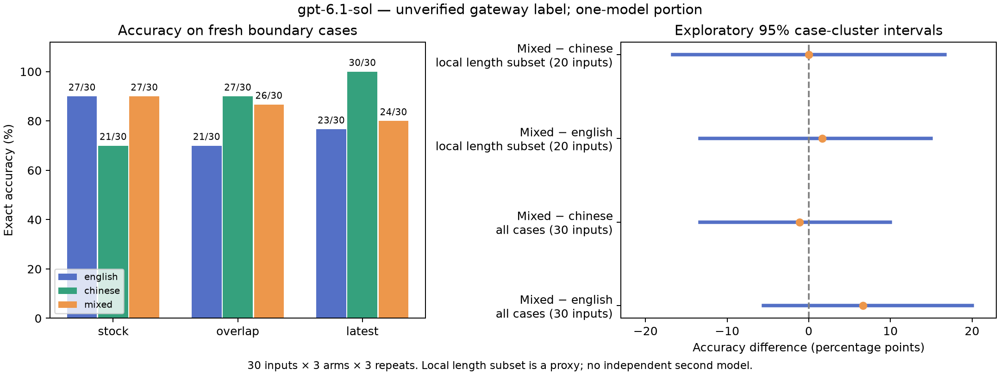

# Three-language control follow-up

This is a targeted exploratory gateway study. Upstream model identities are unverified.

Completed **270 target answers** on **30 fresh opaque-ID inputs**, with three arms and three repeats. **Only one gateway label was available; the planned second-model comparison remains incomplete.**

The supplied Gemini connection returned HTTP 400 during semantic review; the Grok connection returned HTTP 403 `routes_paused`. Neither produced benchmark answers. Those failures and the first successful GPT review are preserved in the setup evidence.

The initial preparation used some descriptive IDs. It produced zero target answers and was replaced by opaque IDs before benchmark inference. Its files are retained as setup history, not as scored inputs. A later single bounded review probe of the listed Gemini low variant also returned HTTP 400.

| Arm | Exact correct | Target-only quota | Median request seconds |
|---|---:|---:|---:|
| gpt-6.1-sol / english | 71/90 | 21,476 | 2.93 |
| gpt-6.1-sol / chinese | 78/90 | 23,180 | 4.27 |
| gpt-6.1-sol / mixed | 77/90 | 22,603 | 2.98 |

Mixed had +6 exact passes versus English and -1 versus Chinese-only. Both all-case paired intervals below include zero. This does not establish a mixing-specific accuracy advantage. Mixed also used **+510 reported input tokens** versus English, with a **+5.25% target-only quota difference** in this run. Neither quantity establishes end-to-end production cost; output usage and cache behavior remain uncontrolled.

| Family | English correct | Chinese-only correct | Mixed correct |
|---|---:|---:|---:|
| stock | 27/30 | 21/30 | 27/30 |
| overlap | 21/30 | 27/30 | 26/30 |
| latest | 23/30 | 30/30 | 24/30 |

Descriptive repeatability (case counts, not an extra independent sample or a chance test):

| Arm | All 3 correct | 1–2 correct | All 3 wrong |
|---|---:|---:|---:|
| english | 20 | 7 | 3 |
| chinese | 24 | 5 | 1 |
| mixed | 21 | 8 | 1 |

Selected posthoc examples: `overlap-5`: english 0/3, chinese 3/3, mixed 3/3; `stock-4`: english 3/3, chinese 0/3, mixed 3/3. These selected examples do not prove a population effect or rule out chance; all case/arm repeat counts and all 44 wrong responses are preserved in the summary. The table also contains variable outcomes on repeated identical prompts.

| Subset | Paired contrast | Difference (percentage points) | Exploratory cluster-bootstrap 95% interval |
|---|---|---:|---:|
| all (30 cases) | Mixed minus english | 6.67 | [-5.56, 20.00] |
| all (30 cases) | Mixed minus chinese | -1.11 | [-13.33, 10.00] |
| local_length_matched (20 cases) | Mixed minus english | 1.67 | [-13.33, 15.00] |
| local_length_matched (20 cases) | Mixed minus chinese | 0.00 | [-16.67, 16.67] |

All run attempts cost **67,715 gateway quota units**, including **456** for the run's semantic review. Earlier setup attempts add **447** from their isolated interval counter, for **68,162** known units in the whole follow-up. Every attempt in the completed GPT run was matched to consumption records; the run's sum reconciles to its interval usage counter. Whole-follow-up setup/target counter reconciliation: **True**. These are not official-provider prices.

Recorded run wall time was **49.3 minutes**, including serial requests, metadata backoff and orchestration. This is distinct from per-request latency and excludes earlier setup attempts and engineering/manual authoring time.

## Interpretation limits

This study tests accuracy controls, not automatic compression admission or end-to-end optimizer savings. No production defaults changed. Mixed means a Chinese rule clause followed by an English clause, not word-by-word search. Translations were author-written and received an automated review from the same gateway label used to answer; no independent bilingual human certified them. The local o200k_base length subset includes 20 cases, not a model-native tokenizer match. All 30 cases remain the primary analysis. That subset contains stock and latest-state inputs only; all overlap inputs fall outside the tolerance, so its task-family composition also changes. The three families were chosen after earlier failures. Repeats are clustered within inputs and the bootstrap resamples cases within family; only three templates and limited structural diversity remain, so intervals do not measure uncertainty across arbitrary tasks or models. A zero-width interval or perfect score on a narrow subset would not establish a zero population effect. Cache behavior, provider-default sampling/reasoning, hidden gateway wrappers and load are uncontrolled. Target-only quota differences exclude authoring labor and any future optimizer preparation. No answer was repaired or rerun based on correctness.

Chinese-only describes the natural-language task instructions. Required field names, the common English system/JSON transport instructions and SOURCE are unchanged across all arms. This common transport wrapper differs from the earlier pilot, so accuracy percentages cannot be compared directly across those studies. No word-level search or automatic token-selection policy was deployed in this control study.

These structured tasks also have deterministic implementations: the oracle can solve them without model calls. This is a prompt-following stress test, not evidence that these workloads require an LLM.

The gateway's metadata endpoints returned HTTP 429 after 15 target trials, with Retry-After 1200 seconds. The run paused without grading answers, honored the cooldown, and resumed the unmodified remaining schedule only after quota/log verification. The recovery amendment reduced metadata polling to at most once per 90 further requests, with the same soft quota caps. This introduces a time gap and possible load/cache drift, and increases possible cap overshoot between checks.

## Reproduce offline

Run `python research/analyze_language_control.py --input <unpacked study directory> --out <new output directory>` with project dependencies installed. The auditor checks frozen hashes, exact request membership, expected-answer oracles, source consistency, attempt provenance and complete quota matching before grading.

