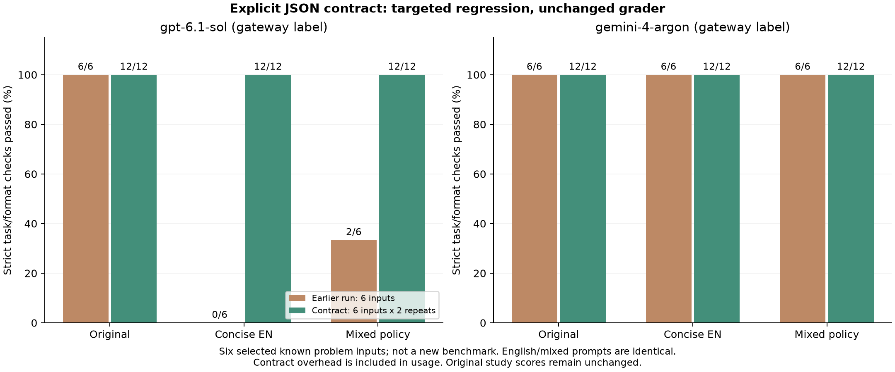

# Explicit JSON output contract: targeted regression

The original transfer study is unchanged. Its GPT-labelled compressed summaries
sometimes contained all required facts but omitted the outer `answer` object.
This follow-up checks an explicit, immutable output-contract intervention.

## Implementation and fixed protocol

`json_object_contract(fields)` returns guidance requiring exactly one top-level
key, `answer`, whose value is an object with the specified nested keys. Pass it as
`Request.output_instruction`, outside editable instructions. It includes a shape
example with placeholders, not expected task answers. The full prompt counter
includes the contract. The helper does not enforce provider schemas, repair a
response, or guarantee model compliance. Returned objects still require validation.

Six known failed summary inputs were selected before follow-up inference:
`handover-01`, `handover-03`, `handover-04`, `handover-05`, `rollout-03`, `rollout-04`.
Each original, concise-English and mixed-policy prompt was retested twice on the
same two gateway labels. The existing user prompt and source were preserved;
only the same per-case output-contract text was appended. Arms were shuffled
within cases using seed 20261104. There was no regeneration, native schema
enforcement, answer repair, or outcome-based retry. Provider defaults, the
4,096-token output limit and per-model concurrency two were retained. Transport
and transient-server failures allow at most two attempts; all returned answers
are graded without silently substituting the original prompt.

The original frozen rubric and task facts were not changed. All concise-English
and mixed-policy prompts are byte-identical on these six summary inputs, so this
regression measures output-contract compliance, not a language-mixing effect.

## Strict checks

| Gateway label | Original after contract | Concise English after contract | Mixed policy after contract |
| --- | ---: | ---: | ---: |
| `gpt-6.1-sol` | 12/12 | 12/12 | 12/12 |
| `gemini-4-argon` | 12/12 | 12/12 | 12/12 |

All 72 follow-up responses passed the unchanged strict checks. No missing wrapper
was observed. Each column contains six unique inputs repeated twice, not twelve
independent questions. On these selected six inputs, the earlier GPT-labelled
scores were 6/6 original, 0/6 concise English and 2/6 mixed policy. The earlier
Gemini-labelled scores were 6/6 for all three arms. Those earlier observations
and the full 50-input study scores remain intact.



This is evidence that the explicit contract addressed the observed wrapper
failure on these cases. Selection on known failures, limited repetitions and
unverified gateway identities prevent a general reliability claim.

## Overhead and limits

The Gemini-labelled endpoint reported roughly 124 extra input tokens per request
on average compared with the earlier same-case prompts. Reported input totals
include that overhead. Before totals contain one request per input, while after
totals contain two; compare per-request averages rather than raw totals.
Output counts also varied, and GPT-labelled input accounting had already varied
on identical prompts in the original study. Gateway prices and invoices remain
unknown. Formatting reliability is not presented as free or as proven net savings.

The intervention was tested on these same known cases, not the other 44 inputs or
new templates. Keep multilingual mixing experimental and continue independent
task/format checking. Stronger validation or provider-native structured output
can be evaluated separately when the provider and its capabilities are known.

## Reproduce without model calls

After installing the project and `.[plots]`:

```bash
python research/analyze_output_contract.py
```

The script verifies the original rubric/source hashes, checks that every prompt
change is append-only, checks case/arm/repetition coverage and regrades all 72
raw answers. Summaries and figures are written to `results/local/output-contract-v060/`.
Recorded artifacts use the `output-contract-v060` prefix in `data/`, `results/`
and `results/figures/`. No credentials are included.
