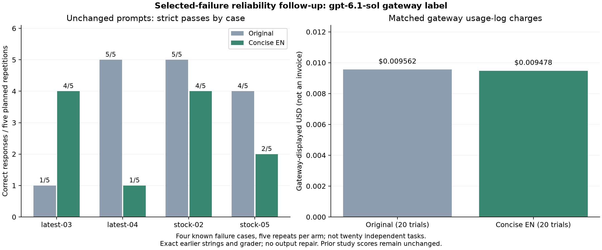

# Selected-failure reliability and charge follow-up

**Decision: keep the v0.6 default-policy change unmerged.** In this targeted
follow-up, concise English passed 11/20 checks versus 15/20 for original prompts.
Its gateway credit charge was only 0.88% lower. That observed tradeoff does not
support enabling compression by default.

This follow-up ran on 4 November 2026 in Asia/Hong_Kong. It is separate from the
earlier 50-input study and the 72-response output-contract regression. Their
prompts, raw answers, rubrics and primary scores remain unchanged.

## Frozen selection and execution

We selected the four distinct cases with incorrect **completed** GPT-labelled
answers in the new-input study: `new-stock-02`, `new-stock-05`, `new-latest-03`,
and `new-latest-04`. The interrupted UTC request was a transport failure and was
excluded from this content-error diagnosis.

For each case we repeated its exact original prompt and exact concise-English
prompt five times: **40 planned trials, 20 per arm**. Each repetition contained
all eight case/arm combinations in a seeded shuffled order. The protocol,
requests, selected cases, original grader and runner were hashed before calls.
There was no candidate regeneration, instruction edit, output repair, or rubric
change. The analysis also verifies that the strings and expected answers still
match the earlier frozen study.

The same unverified `gpt-6.1-sol` gateway label and connection were used, with
two concurrent requests, default sampling/reasoning, a 4096-token output limit,
streaming, and a 60-second per-attempt deadline. The protocol allowed at most
two attempts for transient failures. All 40 responses completed on their first
attempt; there were no transport failures or retries in this execution.

## Accuracy

| Case | Original, five repeats | Concise English, five repeats |
|---|---:|---:|
| latest-03 | 1/5 | 4/5 |
| latest-04 | 5/5 | 1/5 |
| stock-02 | 5/5 | 4/5 |
| stock-05 | 4/5 | 2/5 |
| **Total** | **15/20 (75%)** | **11/20 (55%)** |

Six of eight case/arm prompt groups produced both correct and incorrect answers
across their five unchanged-prompt repetitions. Therefore model/gateway response
variability contributes to the failures. Concise English nevertheless performed
worse in this run. These results do not justify blaming every failure on the
model or assuming that a shorter instruction preserves task reliability.

In the 20 case/repetition pairs, both arms passed eight times, both failed twice,
only the original passed seven times, and only English passed three times.
These are four selected known cases, **not 20 independent questions per arm**.
No significance claim, global accuracy estimate, or isolated causal attribution
to compression follows from these counts.

Median client request time was 2.44 seconds for originals and 5.60 seconds for
English under concurrent gateway load. These timings are descriptive and do not
establish an intrinsic model-latency effect.

## Matched gateway credit charges

For this execution we measured charges from gateway consumption logs rather than
only applying public rate formulas. We captured a private key-specific
`total_used` baseline and final counter through `/api/usage/token/`, and retrieved
read-only `/api/log/token` records. Each of the 40 responses supplied a request ID
that matched exactly one consumption record. Unrelated history was discarded.

The matched records summed to **9,520 quota units**, exactly the key-specific
counter increase. A later counter read was unchanged. The gateway's public
`/api/status` advertised **500,000 quota units per USD display unit**.

| Arm | Trials | Matched charged quota | Gateway-displayed USD credits |
|---|---:|---:|---:|
| Original | 20 | 4,781 | $0.009562 |
| Concise English | 20 | 4,739 | $0.009478 |
| **Total** | **40** | **9,520** | **$0.019040** |

English's reduction was **42 quota units = $0.000084 = 0.88%** in this sample.
Reported input usage fell from 93,930 to 93,390 tokens, while reported output
usage rose from 571 to 581 tokens. These include the full source and output
contract plus opaque gateway overhead. Earlier preparation was reused with no
new translation or candidate-generation API calls; human labor and historical
preparation are excluded from this comparison.

This verifies the gateway's **reported usage-credit debit**, not a bank payment,
tax invoice, underlying provider identity, or independently audited settlement.
The public artifacts retain only matching request-level charges, public unit
metadata and interval deltas. They exclude keys, token names, account balances,
lifetime counters, IP addresses and unrelated account records.

The measurement follows the upstream New API implementations of
[key usage counters](https://github.com/QuantumNous/new-api/blob/main/controller/token.go)
and [key-specific logs](https://github.com/QuantumNous/new-api/blob/main/controller/log.go).
The site's live reporting and configuration remain gateway-controlled. This
follow-up does not retroactively establish the earlier study's actual charges.

## Interpretation and release status

The proposed accuracy-preservation criterion failed on this selected sample.
The measured 0.88% credit reduction does not compensate for the observed drop in
correct answers. Keep the current v0.6 default-policy proposal unmerged. The JSON
contract helper and research artifacts can be assessed separately from a policy
that automatically chooses shorter instructions.

A useful next implementation direction is to retain original prompts unless a
specific transformation has task-level validation, and to keep multilingual
rewrites experimental. Such a policy change needs its own implementation and
evaluation; this follow-up changes research evidence only.



## Offline reproduction

```bash
pip install -e ".[plots]"
python research/analyze_reliability_v060.py results/reliability-v060 --out results/local/reliability-v060
```

The analysis verifies frozen hashes, earlier prompt/case identity, every attempt,
the unchanged grader, request-ID charge attribution and counter reconciliation.
It regenerates the summary and PNG/SVG/PDF figure without credentials or calls.
The original 50-input bundle must remain present for the identity checks.
