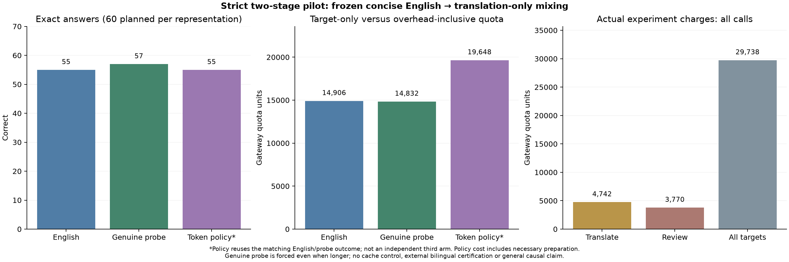

# Strict two-stage pilot: freeze English, then translate

**No incremental token saving: the actual policy kept frozen English for every case.**

English was fixed byte-for-byte before any translation call. Stage two received
only English segments, their hash and requested language names; it received no
original long instruction, source payload or expected answer. Translator output
cannot replace English segments. The same frozen English is used for baseline
answers, candidate comparison and equivalence review.

| Representation | Recorded answer observations | Exact passes | Target-only known quota |
|---|---:|---:|---:|
| Frozen concise English | 60 | 55 | 14,906 |
| Forced shortest-genuine diagnostic | 60 | 57 | 14,832 |
| Actual token policy* | 60 | 55 | 14,906 |

*Policy observations reuse the matching English or diagnostic response for each
case/repetition. They are not an independent third arm or extra paid calls.
When policy retains English for all twenty cases, its target accuracy equals
the English baseline by construction; only the forced diagnostic tests an
actual instruction-language change.
English is retained unless a genuine candidate is strictly shorter and passes
the separate, fallible equivalence review. Ties retain English. A diagnostic
is tested even when longer; it is not automatically selected or deployed.

The matched diagnostics had 5 mixed-only and
3 English-only exact passes. This is a small, clustered
sample, not a pooled significance test or proof of a general accuracy advantage.
The public summary retains all phase outcomes, errors and request IDs.

Post-hoc case-level inspection locates the difference. Mixed passed all three
repetitions on `strict-overlap-2` and `strict-latest-2`, where English passed one
of three each, and on `strict-stock-2`, where English passed two of three.
The opposite result was repeatable too: `strict-stock-1` passed three of three
in English and zero of three in mixed form. All other sixteen inputs passed
every repetition in both forms. These few shared-task clusters do not establish
a stable overall advantage. The eight errors were task-rule errors, not invalid
JSON wrappers; `error-inspection.json` preserves their exact source, instructions,
expected values and actual responses. This inspection did not repair or rerun
any test. Translation wording, bilingual reference binding, arithmetic and
sampling are possible follow-up explanations, not proven causes.

## Preparation overhead and actual charges

The minimal policy accounting scenario used **19,648 quota units**, versus **14,906** for the already-compressed English baseline: **31.81% more quota** at the pilot's reuse level. This includes 4,742 units of necessary preparation.

| Phase | Planned model requests | HTTP attempts | Known charged quota |
|---|---:|---:|---:|
| Translate frozen English | 10 | 10 | 4,742 |
| Review genuine diagnostics | 10 | 10 | 3,770 |
| All target arms | 120 | 120 | 29,738 |
| **Actual entire experiment** | | | **38,250** |

Counter reconciliation: **True**. Missing attempt charges:
**0**. All first repetitions and failed/retried
attempts remain included. Gateway quota and percentages are reported; these are
not official-provider prices or actual-money estimates.

Reviews of longer candidates are needed only for the forced diagnostic. The
actual token policy can reject a longer candidate without paying for a review.
`cost-allocation-before-target.json` declares that distinction after ranking,
before inspecting review/target answers. Minimal accounting includes every
translation call and only policy-required reviews, plus selected target charges.
The conservative all-preparation scenario also includes all diagnostic reviews:
**23,418 units**. The original protocol is
retained, and both scenarios are explicit. The actual experiment total above
includes every diagnostic review and every diagnostic target call.

For readers considering always using the longer approved mixed representation,
its all-preparation accounting scenario is **23,344
units**, or **56.61% more** than
English at this pilot reuse level. Its target-only charge difference was
-0.50%; that small target-only difference
excludes preparation and does not establish end-to-end savings. This is another
explicit accounting scenario, not a third independently executed deployment.

The policy accounting scenario reuses six target observations per template
(two source variants, three repetitions). It is not a separately executed
standalone production bill. Interleaved baseline/diagnostic traffic may affect
cache state; projected amortization cannot be treated as guaranteed savings.
Human English authoring, engineering and tokenizer CPU overhead are unmeasured.

## What was built and tested

Stage one reuses the previously selected concise English clauses with the
conservative PromptMin baseline. They are not tuned on these fresh answers or
claimed to be the strongest available English compressor. The new stage is
translation-only, with immutable English provenance and a full-prompt token
comparison against that exact baseline.

The public API provides `freeze_english`, `translation_job` and
`rank_translations`. It validates exact English partitioning, prevents translator
English replacement, enforces numeric/literal guards and preserves source and
output-contract bytes. The pure ranking API makes no model calls and does not
certify meaning or release task answers. Stage-one compression and task
validation remain the caller's responsibility. Existing defaults stay original-only.
This is a separate composable API and study workflow. The existing `mpo auto`
command is not migrated to the strict pipeline by this preview; its previous
explicit opt-in behavior remains unchanged.
Inside the second-stage pool, the internal label `original` means the frozen
English baseline, not the long pre-compression instruction.

```python
from multilingual_prompt_optimizer import Request, freeze_english, translation_job, rank_translations

english = Request("Keep valid records. Return IDs in input order.", payload="SOURCE DATA", output_instruction="JSON only.")
frozen = freeze_english(english, ["Keep valid records.", "Return IDs in input order."])
job = translation_job(frozen, languages=("zh",))
# Send job['system'], job['data'] and job['schema'] to your chosen translator.
translations = {"translations": [{"zh": "保留有效记录。"}, {"zh": "按输入顺序返回ID。"}]}
ranked = rank_translations(frozen, translations, languages=("zh",))
# ranked['pool'] is structural/token ranking, not semantic approval.
```

The tested units are two aligned natural-language clauses per instruction,
not arbitrary word-by-word substitution or a whole-prompt translation. Chinese
and Japanese were requested as alternatives; the artifact records exactly which
languages the shortest genuine diagnostic used. English segments in a mixed
candidate are copied directly from the frozen baseline.
Across the sixty measured target requests per arm, reported input usage was
276,318 for English and 276,612 for the mixed
diagnostic: **294 more reported input tokens**.
The token result therefore was not based only on the local selection proxy.
Each language supplied one translation per clause; the pool is not an exhaustive
search over paraphrases, segmentations or all languages. A negative result here
does not prove that every possible mixed representation is unhelpful.

Twenty fresh synthetic payloads cover ten known task families and three repeats.
Values, threshold decisions, missing/empty values, dependency readiness, UTC
winners and ranking eligibility vary; expected answers were hand-specified and
checked against deterministic rule implementations before inference. This is
not an independently curated benchmark or a claim about unseen task types.

One unverified `gpt-6.1-sol` gateway label translated, reviewed and answered.
Model judgments are correlated and fallible, not independent bilingual
certification. No monolingual translated control isolates code switching from
translation wording/language choice. Default sampling and cache state are not
controlled; there is no free warm-up, cache reset, answer repair or output-based
candidate tuning. The English, review and target freezes verify ordering before
their respective calls. A 75,000-unit whole-experiment soft stop was checked
after each preparation phase and each 30 target requests; it was not a guaranteed
ceiling. No alternate key bypassed a limit.



## Earlier extraction finding: saved-data sensitivity check

The earlier 5.90% English-compression result was not created by a single lucky
case. All 60 paired calls used exactly 64 fewer reported input tokens; all three
repetitions showed lower quota (5.47%, 6.99%, 5.25%). Seventeen of 20 case clusters
were cheaper across their three repeats. For 30 pairs with equal reported cache
counts and equal output lengths, compression used 19–20 fewer quota units in
every pair. Leaving any one case out kept the observed reduction between
4.95% and 7.01%.

That is descriptive robustness, not a formal chance probability or a causal
cache proof. Both arms already passed 60/60, and the three-field projection is
computable without an LLM; it showed no accuracy advantage and no multilingual
benefit. The exact percentage remains conditional on that single-schema cached
run. `prior-extraction-audit.json` preserves this post-hoc check without new API
calls or changes to prior scores.

## Reproduce offline

```bash
python -m pip install -e ".[dev,plots]"
python research/analyze_strict_two_stage.py results/strict-two-stage-v060 --out results/local/strict-two-stage-v060
```

The earlier English/genuine-mixing bundles and cached `o200k_base` encoding are
required. This recounts and audits saved data without inference or billing calls.
No earlier result, admission decision or default policy is replaced by this pilot.
