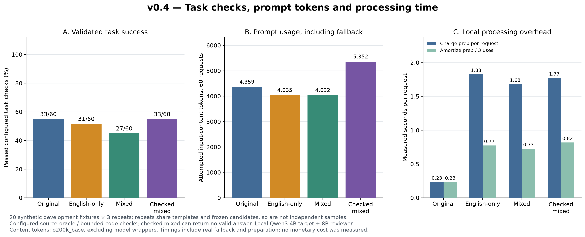
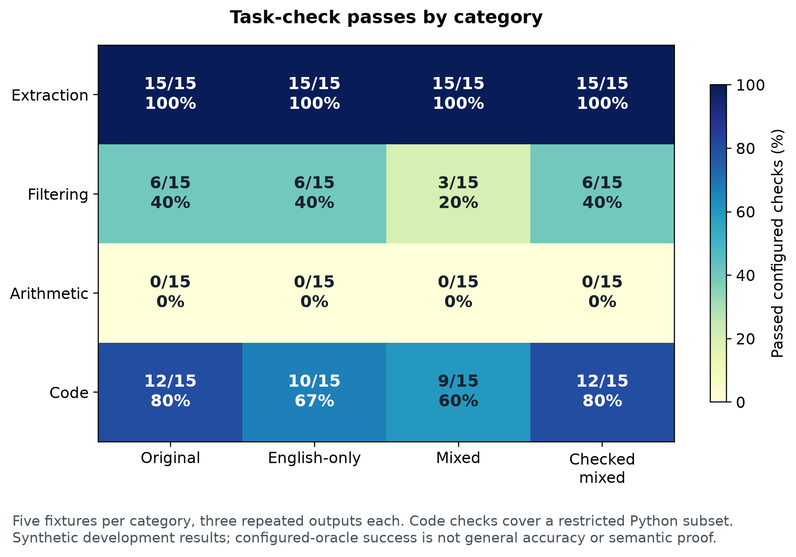

# v0.4: checking actual task answers

Version 0.4 adds configured answer validators and a fallback policy. In the local
development experiment, checking recovered losses from compressed prompts, but
used more prompt tokens and processing time. It did not demonstrate a cost or
accuracy advantage over the original prompts.



## Experiment

The assistant authored 20 synthetic fixtures: five extraction, five filtering,
five arithmetic and five small Python-function tasks. Some share task templates.
They are development examples, not a held-out accuracy benchmark. All inputs,
instructions, configured oracles and code tests are in
`data/task-quality-development.json`.

Qwen3 4B generated one EN/ZH/JA phrase pool per fixture. Qwen3 8B reviewed candidate
instructions. English-only and mixed-search candidate prompts were prepared once,
then frozen across three target-model repeats. Each fixture therefore contributed
three original, three English-only and three mixed target calls. Trial arm order
was shuffled with a fixed seed. Temperature was zero; inference still varied.

The target was local Qwen3 4B. All arms used the same JSON transport instruction
and type schema; those schemas did not contain correct values, selection counts,
or hidden code tests. Oracles were never sent to the models. Model calls contained
only the task request, its source payload and unchanged output instruction.

Checked mixed shares the measured mixed first attempt, validates its answer, and
makes a **real fresh original-prompt call** when that answer fails and the candidate
differs from the original. It never reuses the original control answer as a free
fallback. If neither attempt passes, it returns `validated=false` and no answer.
If optimization already retained the original, an invalid answer is blocked without
duplicating an identical call. The checked arm is consequently dependent on the
mixed arm's first answers, not an independent fourth sample.

## Configured validators

- Extraction: exact output keys and values derived from source JSON paths, including
  Unicode names, numeric values and nulls for missing paths. Extra keys fail.
- Filtering: source-derived ID lists with explicit AND/OR conditions, thresholds,
  missing/null fields and ordering. Missing or extra IDs fail.
- Arithmetic: Decimal-based reference calculations with declared half-up rounding
  to two decimals. Numeric strings and Boolean values are not accepted as numbers.
- Code: parse one Python function and interpret a small bounded AST subset against
  configured test inputs. No model-written code is executed with `exec` or `eval`.
  Imports, arbitrary calls, attributes, loops, recursion and unsupported syntax fail.

The code checker covers a restricted subset, not arbitrary valid Python. A valid
algorithm outside that subset can fail the check. The recorded mixed average
response added top-level test/print calls despite a function-only request, and was
rejected. Finite code fixtures are not formal verification.

These rules require a task-specific configuration. They do not infer an oracle for
arbitrary prose and do not automatically solve the earlier summary/date failure.
The generic `auto` command still reviews instructions only. The new checked API
and demonstration apply when an application supplies a suitable validator.

## Results

| Policy | Passed checks / 60 | Pass rate | Attempted content tokens | Target calls | Actual original fallback calls |
| --- | ---: | ---: | ---: | ---: | ---: |
| Original | 33 | 55.0% | 4,359 | 60 | 0 |
| English-only | 31 | 51.7% | 4,035 | 60 | 0 |
| Mixed search | 27 | 45.0% | 4,032 | 60 | 0 |
| Checked mixed | 33 | 55.0% | 5,352 | 81 | 21 |

Mixing saved only **3 content tokens beyond English-only** across 60 first attempts.
Unchecked mixing passed six fewer checks than the original. The checked policy
recovered those six cases through actual original fallback, but still withheld an
answer on 27/60 requests because no attempted answer passed the configured checks.
No failed-check answer was released by that policy, by construction of the gate;
this does not establish correctness outside the configured oracles.

Checked mixed attempted 22.8% more prompt-content tokens than original. Tokens are
`o200k_base` counts of full user-message content, excluding model wrappers. They
include all actual fallback prompt content; failed requests are not credited as
zero-token savings.



The original model also failed tasks. It passed no arithmetic fixtures in this
non-thinking configuration. For example, the invoice reference was 67.10 but the
recorded original response was 0.0. The source-derived calculation was checked
separately. Filtering failures included excluding an eligible cancelled order when
cancellation was not an exclusion criterion, and returning an ID instead of an
empty array.

The absolute-value code fixture encountered service errors in every scored arm.
A separate post-run diagnostic returned HTTP 500 with `prediction aborted, token
repeat limit reached`. Those trials remain failures in the denominators; the
extra diagnostic is not scored. The client now distinguishes an HTTP server error
from an unavailable service. This separates execution failures from incorrect
answers and does not make the model's task performance better.

## Processing overhead

| Policy | Seconds/request, preparation each request | Seconds/request, preparation reused across 3 executions |
| --- | ---: | ---: |
| Original | 0.23 | 0.23 |
| English-only | 1.83 | 0.77 |
| Mixed search | 1.68 | 0.73 |
| Checked mixed | 1.77 | 0.82 |

Preparation includes generation, search and review. The experiment prepared each
fixture once; standalone timing charges that measured preparation once per request,
while reuse timing divides it across the three executions. Both include actual
target inference, validation and any fallback. They are measurements/accounting
estimates on this machine, not service-wide latency predictions. Fixed preparation
order, loading and caching affect timings; the slightly lower mixed preparation
time is not evidence that mixed search is intrinsically faster than English-only.

The experiment made 20 generation calls, 42 review calls and 201 target calls.
The 201 count includes 21 real fallbacks; do not double-count the shared mixed first
attempt when adding policy totals. Available local-model usage is preserved per
call. Token usage for failed service calls was unavailable, so aggregate available
usage is incomplete for those failures. Local-model tokens are not interchangeable
with `o200k_base` content counts. No API bills, energy use or monetary costs were
measured. There is no demonstrated net-cost benefit.

## Limits and reproduction

The run used Ollama 0.40.13, the model digests in the report, and an NVIDIA RTX 5070
Ti. The data, generation/review protocol and validators were not tuned to improve
these scored outcomes. Three repeated outputs on each of 20 fixtures are not 60
independent task instances. No confidence intervals or generalization claims are
attached to these rates. Configured-oracle success is narrower than general task
accuracy, and limited tests can miss code defects.

The full record is `results/task-quality-v040.json`. Validator provenance was
recorded after the run against the unchanged validator source; the runner captures
it before future runs. Plot provenance and the result-file hash are in
`results/figures/v040-plot-manifest.json`. PNG, SVG and PDF exports are included.
Canonical JSON hashes are included alongside byte hashes so the data can be
verified after Git normalizes text-file line endings.

```bash
python -m pip install -e ".[dev,plots]"
python research/evaluate_task_quality.py --output results/local/task-quality.json
python research/plot_task_quality.py --input results/local/task-quality.json --output-dir results/local/figures
python research/run_checked_case.py --id F03 --output results/local/checked-demo.json
```

Start Ollama and pull `qwen3:4b` and `qwen3:8b` first. The checked demo validates
the high-priority/unassigned-task IDs against the actual source JSON. It may need
fallback; it reports the attempts and exits nonzero if no valid answer is available.

The next research step is fresh held-out fixtures, stronger target execution or
tool-based arithmetic, and task-specific acceptance criteria before testing any
cost benefit. More languages alone would not address the failures measured here.
