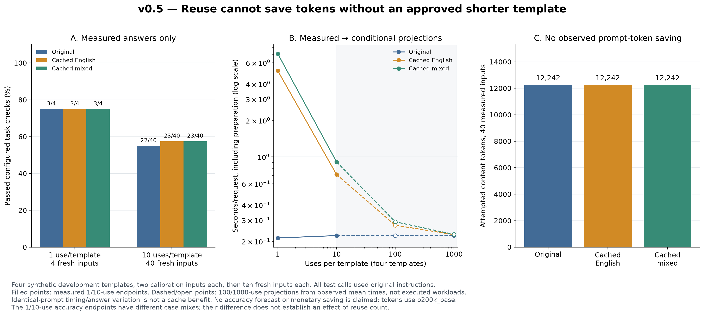
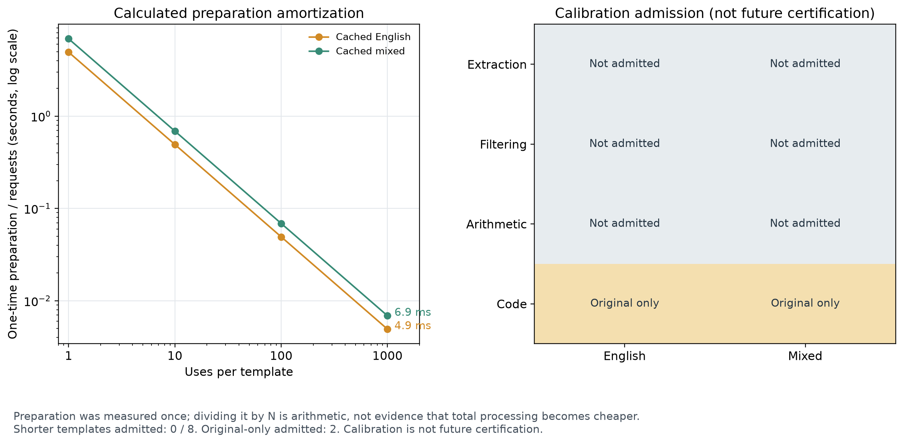

# v0.5: reusable instruction templates

Version 0.5 adds an instruction cache, invalidation checks, per-input recounting and
a reuse experiment. **This run found no approved shorter template to reuse.** All
fresh-input calls used the original instructions and all three policies attempted
the same number of prompt-content tokens. Reuse did not demonstrate an efficiency
advantage in this configuration.



## Design and separation of inputs

Four longer templates cover extraction, filtering, invoice arithmetic and repairing
an average function. The instructions contain 237–250 `o200k_base` tokens. These
are task constraints rather than repeated filler text. The representative complete
prompts contained 264–341 tokens, including source data and the output instruction.

Each template has two calibration inputs and ten different test inputs. The split
was frozen before generation. Test values are fresh relative to v0.4 and excluded
from cache admission. They remain synthetic development designs using familiar task
families and assistant-authored oracles, not an independently curated external test.
There are 40 test inputs and one target execution per policy/input, not 1,000 actual
executions. See `data/template-reuse-development.json` for the complete fixture set.

Qwen3 4B generated a shared English/Chinese/Japanese phrase pool once per template.
Its output budget was raised to 4,096 tokens with an 8,192-token context for these
longer instructions. Qwen3 8B reviewed shorter English-only and mixed combinations,
with up to eight reviews per arm. The original remained the fallback. English-only
was taken from the shared multilingual generator; it was not a separately optimized
English compression model. This remains a baseline limitation.

For each selected instruction, the two calibration answers had to pass the
configured task checks. The actual candidate had to be applied; an original
fallback could not count as a passing calibration of a different candidate. Failed
preparation or calibration stores the original as a rejected entry. An original
instruction can pass calibration without representing any compression.

## Cache behavior

`TemplateCache` saves instructions, calibration flags and identity metadata. It does
not store source payloads or task answers. The experiment's full traces separately
contain its synthetic inputs and responses.

The key includes the original instruction, output constraint, protected literals,
mode, tokenizer identity/library versions, generation and review model revisions
and options, and caller-provided protocol/validator fingerprints. The study protocol
also includes the target model revision/options. Applications must supply current
identities; the cache cannot discover whether an opaque caller-provided fingerprint
is truthful. Calibration flags are an application contract, not a signed attestation.

Writes use atomic replacement. A checksum detects accidental corruption; it does
not protect against an attacker who can rewrite the file and recompute the checksum.
Identity mismatches, malformed entries and failed checks become misses or original
fallbacks. Source data is intentionally excluded from the key so new inputs can
reuse the template.

Every application still composes and counts the complete prompt for that new
payload, runs numeric/literal guards, and retains the original if the cached
instruction would increase tokens. Every task answer is still checked against its
configured source-derived oracle; a changed prompt may need a real fresh original
fallback call. Passing two calibration examples does not certify future answers.



## Observed admission and outcomes

No shortened instruction passed the complete review/calibration process in either
arm. Shorter candidates were rejected by the model reviewer or no shorter candidate
was available. Some review reasons confused an instruction with the requested task
answer, such as saying a rewrite lacked Python code, or treated language changes as
violations. This is evidence of reviewer limitations on long templates, not proof
that all rejected candidates were semantically wrong.

The selected extraction, filtering and arithmetic instructions were originals and
failed calibration. The code original passed both calibration examples and was
cached as an original-only admission. Thus the two arms had **zero shortened
admissions out of eight template/arm combinations**, with two original-only
admissions. Rejected entries also remember the original fallback and avoid repeating
the same preparation work when their identities remain unchanged.

| Policy, ten fresh inputs per template | Passed checks / 40 | Changed test prompts | Attempted content tokens | Fresh-input fallback calls |
| --- | ---: | ---: | ---: | ---: |
| Original | 22 | 0 | 12,242 | 0 |
| Cached English + checks | 23 | 0 | 12,242 | 0 |
| Cached mixed + checks | 23 | 0 | 12,242 | 0 |

The extra passing answer in the cached arms is **not evidence that caching improved
accuracy**: all input prompts were identical, and the model produced different
answers under different execution states/orders despite temperature zero. The
original control is scored with the same oracle; the checked policies withhold an
answer when it fails. Their 23/40 validated outputs leave 17 requests without a
validated answer.

Original per-template passes were 9/10 extraction, 2/10 filtering, 1/10 arithmetic
and 10/10 code; both cached arms were 9/10, 3/10, 1/10 and 10/10. These figures
characterize this small local setup, not general task accuracy. The one-use endpoint
uses only the first input of each template (four inputs), while the ten-use endpoint
uses all 40. Their different case mixes prevent interpreting the accuracy difference
as an effect of reuse count.

## Preparation and reuse accounting

Measured standalone preparation across the four templates was 19.70 seconds for
English and 27.52 seconds for mixed search. It includes generation, search, review,
calibration execution and cache writing. Generation was shared in the experiment
but is charged once to each hypothetical standalone candidate policy. Original
calibration controls were experimental measurements, not a required original-policy
preparation charge. Calibration arm order alternated between templates; model
loading, context changes, prefix caching and warm-up can still affect timings.

The experiment made four generation calls, 27 review calls and 144 target calls,
including calibration/controls and fresh inputs. No repeated preparation model
calls were made while applying a cached entry to a new test input. A separate cache
hit demonstration also used zero preparation calls and one validated target call,
with zero token reduction. That demonstration is not an additional independent
accuracy trial.

| Uses per template | Status | Requests across four templates | Original seconds/request | Cached English seconds/request | Cached mixed seconds/request |
| --- | --- | ---: | ---: | ---: | ---: |
| 1 | Measured prefix | 4 | 0.213 | 5.138 | 7.106 |
| 10 | Measured | 40 | 0.223 | 0.715 | 0.910 |
| 100 | Conditional projection | 400 | 0.223 | 0.272 | 0.290 |
| 1,000 | Conditional projection | 4,000 | 0.223 | 0.228 | 0.229 |

For measured endpoints, preparation is added once to the actual prefix execution
time. For the larger-use projections, the same preparation is added once to N times
the observed mean execution time per template. These assume future inputs resemble
the ten observed inputs and the model/setup remains fixed. The 100/1,000 workloads
were **not executed**, and their accuracy is not projected.

Dividing measured preparation by the request count gives approximately 4.9 ms per
request for English and 6.9 ms for mixed at 1,000 uses per template. This arithmetic
amortization does not establish a total-cost saving. There was no shorter prompt,
and target inference still had to occur for every request.

Raw observed execution times differed by less than two milliseconds per request
between the identical-prompt policies. A naive fit could turn that variation into
a spurious distant crossover. The analysis therefore gives **no meaningful
break-even estimate when no distinct prompt was applied**. Measured calls, timing
variation and conditional projections are retained rather than rewritten into a
claimed speedup. No API bills, energy use or monetary costs were measured.

## Provenance and limits

The full record is `results/template-reuse-v050.json`; canonical data and source
fingerprints support verification across Git line-ending normalization. The target
profile was explicitly added to the cache identity from actual scored-call metadata
after the run, and entries were rewritten with that identity. Calls, calibration
flags, chosen instructions and scored outcomes were unchanged. The report records
this enrichment. A post-run analysis correction suppresses identical-prompt
timing-jitter crossover claims; it does not change any measured outcomes.

The setup used local Ollama 0.40.13, Qwen3 4B generation/target execution, Qwen3 8B
review, and an NVIDIA RTX 5070 Ti. Revisions/options are in the record. Configured
oracles and the bounded Python subset have the same limitations as v0.4. The weak
target-model calibration outcomes and overstrict reviews prevent this experiment
from evaluating the payoff of a genuinely validated shorter template. It does not
disprove reuse in general.

The next useful step is a stronger, independently evaluated concise-English
generator and a reviewer calibrated on long instruction equivalence. Reuse
economics should then be tested only after a shorter template actually survives
quality checks. Adding larger hypothetical reuse counts to this failed preparation
would not fix it.

## Reproduce

Start local Ollama with both models installed, then run from the repository root:

```bash
python -m pip install -e ".[dev,plots]"
python research/evaluate_template_reuse.py --output results/local/template-reuse.json --cache-dir results/local/template-cache --refresh
python research/plot_template_reuse.py --input results/local/template-reuse.json --output-dir results/local/figures
python research/run_cached_template.py --study results/local/template-reuse.json --cache-dir results/local/template-cache --template code
```

The benchmark requires a fresh cache or `--refresh` so preparation cannot silently
be treated as free. The cache demo checks current model identities/options and
reconstructs protocol/validator fingerprints; a mismatch requires recalibration.
Local cache files are ignored by Git. PNG, SVG and PDF graphs are included with a
plot manifest; the library has no plotting dependency unless `.[plots]` is installed.
