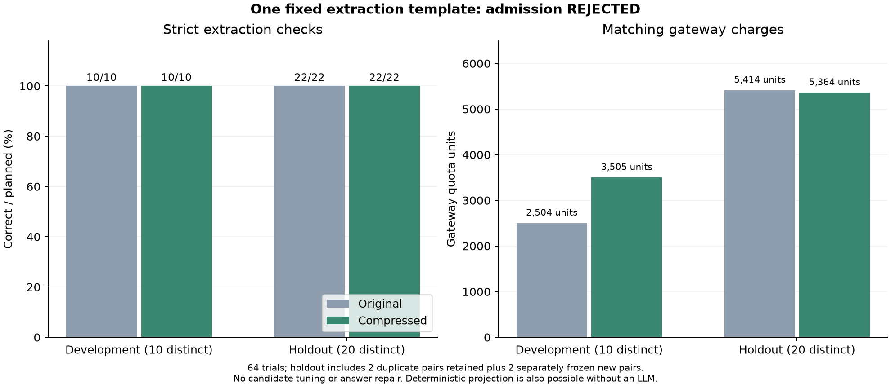

# Evidence-gated JSON extraction (0.6.0a4)

`JsonExtractionTemplate` is an explicit experimental mode for projecting named
scalar fields from a JSON object. Original-preserving defaults are unchanged.
The selector retains the original unless all admission conditions pass and the
new complete prompt is shorter under the configured counter.

## Admission and runtime behavior

Evidence is bound to the two instructions, field paths, immutable output
contract, caller-declared target/model/options identity, and tokenizer name.
The gate recomputes exact answers from raw responses instead of trusting pass
flags. It requires paired original/compressed trials with:

- At least ten distinct development payloads and twenty distinct holdout
  payloads. Canonical JSON payloads cannot cross splits; repeated observations
  within a split never inflate distinct coverage.
- Zero answer errors or incomplete responses in either arm and split.
- Unique response request IDs with complete charge attribution, nonnegative
  integer quota, and a reconciled total debit.
- Strictly lower compressed charges in **both** splits, including the entire
  stated preparation fee in each comparison. Unknown preparation costs reject
  admission; zero means an explicitly recorded zero API preparation fee.

Source scope is a JSON object up to 16 KiB, string-key object paths, and finite
scalar outputs. Missing/null paths return null; strings, booleans and numeric
strings retain their types and contents. Arrays/objects at a requested output,
nonobject intermediates, duplicate keys and nonfinite numbers are unsupported.

`select` only returns a prompt and audit result. `execute` additionally validates
each raw model answer against the exact projection. A wrong compressed answer
triggers an original-prompt retry. If neither passes, no answer is released. If
the source cannot be validated, execution makes no call and releases no answer;
the original prompt remains available in the selection record.

Evidence is local supplied data, not signed certification. The target identity
is a caller assertion, not proof of the upstream model. Finite fixtures do not
guarantee future reliability or savings. Runtime fallback inference can erase
savings. No general-purpose semantic validator is introduced.

## Frozen live experiment and result

One manually authored candidate was frozen before all target calls. The model
was the same unverified `gpt-6.1-sol` gateway label, with default sampling,
streaming and a 4096-token limit. No generation/translation API calls prepared
the candidate; human authoring labor is unknown.

The initial corpus had ten development fixtures and twenty holdout fixtures.
A pre-analysis canonical-payload audit found two duplicate holdout pairs:
903/913 and 905/915. The initial corpus, requests and receipts were preserved.
Two separately frozen new cases added four calls without changing the
candidate, answer grader, or old responses. No target answers were graded or
used to tune those additions. The admission coverage rule was clarified before
grading to count distinct payloads, retaining all duplicate observations in
quality and cost totals. Both implementation snapshots and the amendment are
included in the evidence bundle.

The final experiment has **64 trials on 30 distinct payloads**: ten development
pairs and twenty-two holdout pairs representing twenty distinct holdout inputs.
There were 69 HTTP attempts including bounded retries.

| Split | Original exact passes | Compressed exact passes | Original charged quota | Compressed charged quota |
|---|---:|---:|---:|---:|
| Development, 10 distinct | 10/10 | 10/10 | 2,504 | 3,505 |
| Holdout, 20 distinct | 22/22 | 22/22 | 5,414 | 5,364 |

All 64 completed answers passed. **Admission was rejected:** compressed
development charges were about 40% higher. Holdout charges were 0.92% lower;
that does not override the development cost failure. Overall charged quota rose
from 7,918 original to 8,869 compressed, about 12% higher. No candidate revision
or selective rerun followed these results.

Matching request-level consumption records summed to **16,787 gateway quota
units**, exactly a stable key-counter debit. Charged
retries are allocated to their trial; the comparison includes all original and
supplemental calls. These are gateway-reported credits, not an invoice or
independently audited provider settlement. Cache, output and routing variation
can affect charges; this run does not identify a single cause of the difference.
Only matching charge records, public units and counter deltas are published.



This exact projection can be computed deterministically without an LLM, through
`template.expected(payload)`. Use that route for simple projection in practice.
The experiment tests the admission and checked-execution machinery; it does not
establish a need for LLM inference, a profitable compression template, or broad
semantic equivalence. All earlier studies remain unchanged.

## Use and reproduce

The later [offline cost audit](extraction-cost-audit.md) decomposes the increase
into an exceptional cache-accounting pair, timeout charges, and the remaining
pairs. It does not alter these scores, remove observations, or admit the template.

```python
import json
from pathlib import Path
from multilingual_prompt_optimizer import JsonExtractionTemplate, TiktokenCounter

base = Path("results/validated-extraction-v060")
template = JsonExtractionTemplate.from_dict(json.loads((base / "template.json").read_text(encoding="utf-8")))
```

Read the compressed evidence with `gzip.open`, then use the exact target identity:

```python
import gzip
with gzip.open(base / "evidence.json.gz", "rt", encoding="utf-8") as stream:
    evidence = json.load(stream)
payload = '{"customer":{"name":"林雨"},"order":{"id":"NEW"},"payment":{"amount":128.5}}'
selection = template.select(payload, counter=TiktokenCounter(), target=template.target,
                            evidence=evidence, allow_compression=True)
assert selection["result"]["selected_label"] == "original"  # recorded cost gate rejected
```

For application inference, call `template.execute` with an executor returning
raw JSON response text, the actual model/config identity, and the same evidence
and opt-in arguments. The API handles exact checking and fallback.

The CLI performs selection only, with no model calls:

```bash
mpo validated-extract --template examples/validated-extraction-template.json --input examples/extraction-source.json --target demo-target-v1
python research/analyze_validated_extraction.py results/validated-extraction-v060 --out results/local/validated-extraction-v060
```

The generic example has no admission evidence and keeps the original. An
enabled CLI experiment additionally needs `--enable-compression`, `--evidence`
pointing to an uncompressed evidence JSON, and an exact target/config match.
The offline analyzer verifies frozen hashes, source/answer identity, all charge
attribution, distinct coverage and admission, then regenerates evidence,
summaries and PNG/SVG/PDF graphs. Install `.[plots]` to reproduce the graph.
